## Creating app client for each customer

According to the multi-tenant application model, we need to create a separate Cognito App Client for each customer and attach their corresponding external OIDC providers.

### Step 1: Creating application client

To create App Client navigate to **Application - App client,** click to **Create App Client**

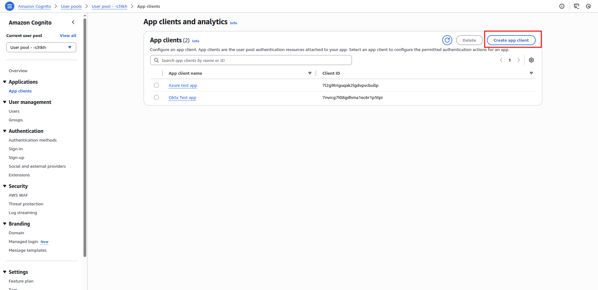

In the setup form, choose **Traditional web application** as the application type.

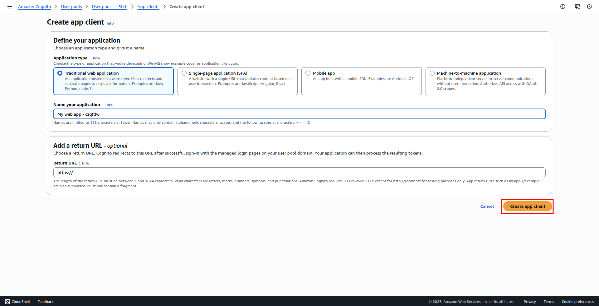

### Step 2: Adding custom attribute

To include user groups in the ID token, we need to add a custom attribute to the Cognito User Pool.

1. Navigate to **Authentication** **-** **Sign Up**, then click **Add custom attribute:**

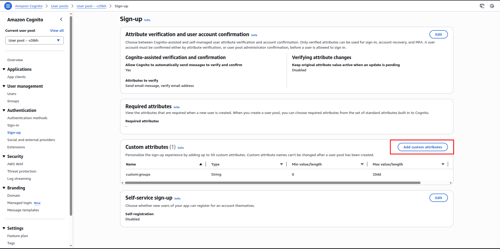

In the form, enter the attribute name as shown below, and then click **Save changes**.

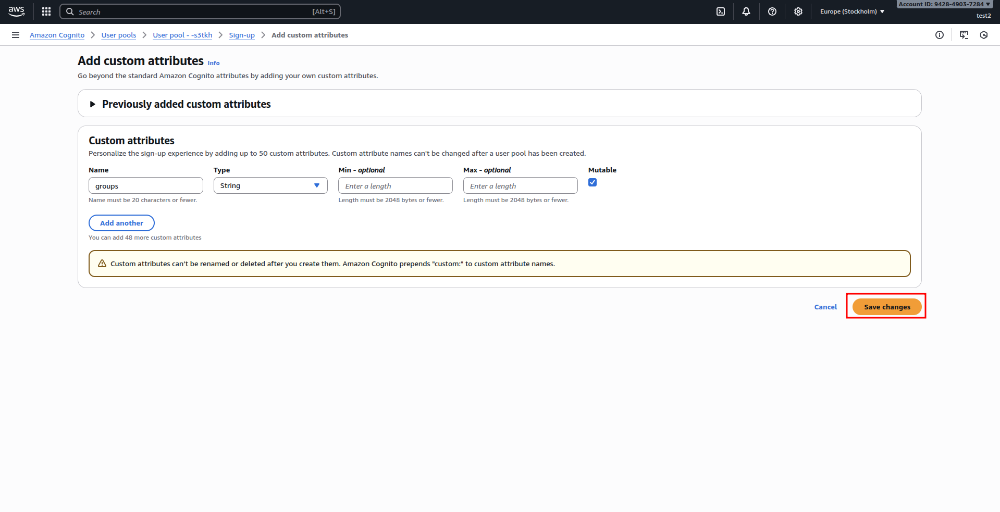

### Adding roles custom attribute

If “**roles**” scope is configured in Customer OIDC provider, you can add a custom “**roles**” attribute as well and include this attribute in External Cognito Provider.

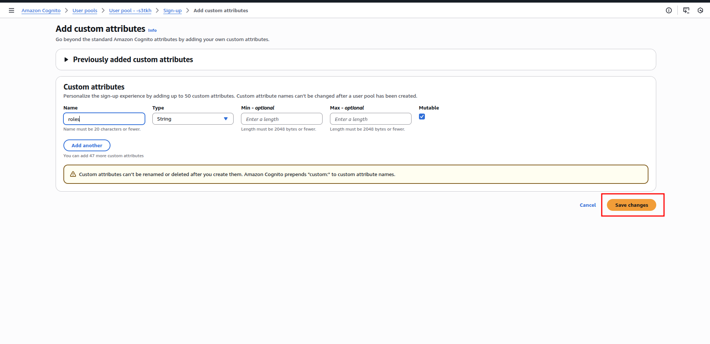

### Step 3: Creating external provider

1. Navigate to **Authentication - Social and external providers**

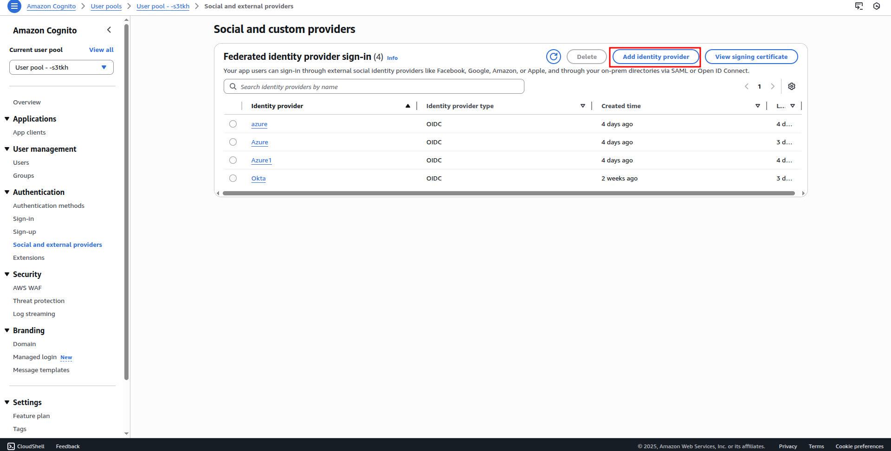

2. In from enter your OIDC Provider credentials, **Client ID**, **Client Secret** and **Issuer URI**.
3. Add custom “**groups”** attributes that you created in the previous step and include **email** attributes. (username will be added automatically after you created the provider).

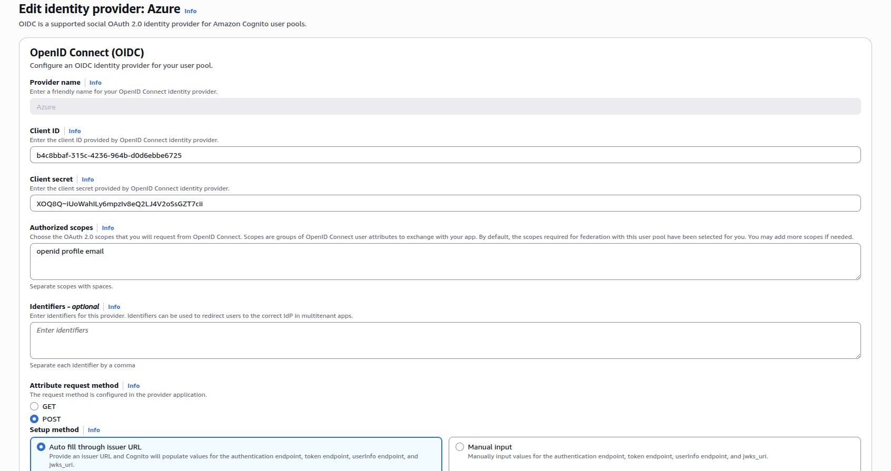

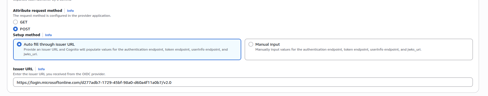

**!Important:** In the form, enter the OpenID Connect attribute to **groups** exactly as shown below, and then click **Save changes**.

**Clarification:** We configure these attributes so that the group and role information (optional) is included in the **ID Token** returned by the Identity Provider. If your application uses different scope names, make sure to update the values in the Cognito accordingly (for example, if Provider sends roles under **app_groups** scope, you should set OpenID Connect attribute to **app_groups**).

**Info:** If you added a “**custom:roles**” attribute in the previous step, you can include the “**roles**” attribute here as well.

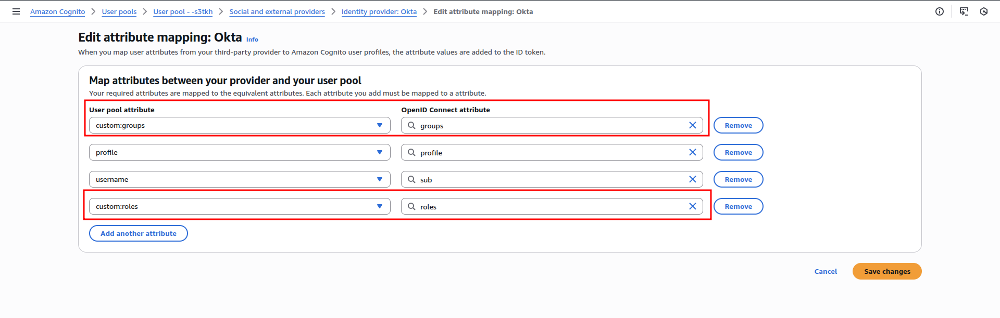

### Step 4: Attach external provider to app client

1. Navigate to **App Clients - Your App - Login Pages**
2. Click **Edit** button.

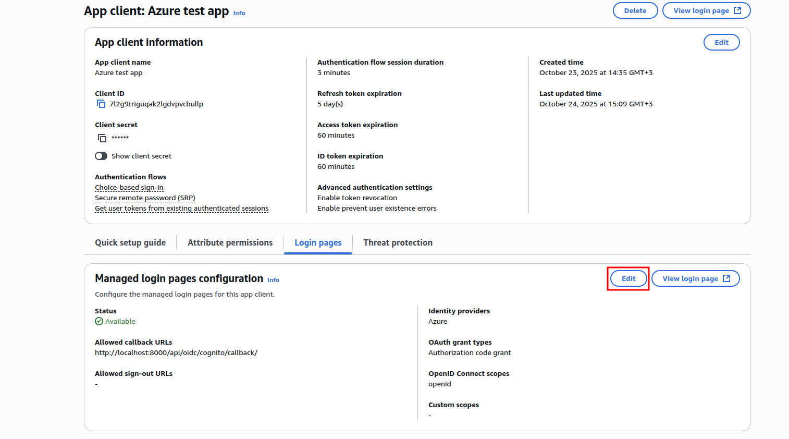

In the configuration form:

1. Add allowed callback URLs (e.g.

**https://yourapp.com/api/oidc/cognito/callback/**

or **http://localhost:8000/api/oidc/cognito/callback/** for local testing).

2. Attach the identity providers you created in the previous steps.
3. **!Important**: Under **OpenID Connect scopes**, select only the **OpenId** scope.
4. Click Save changes.

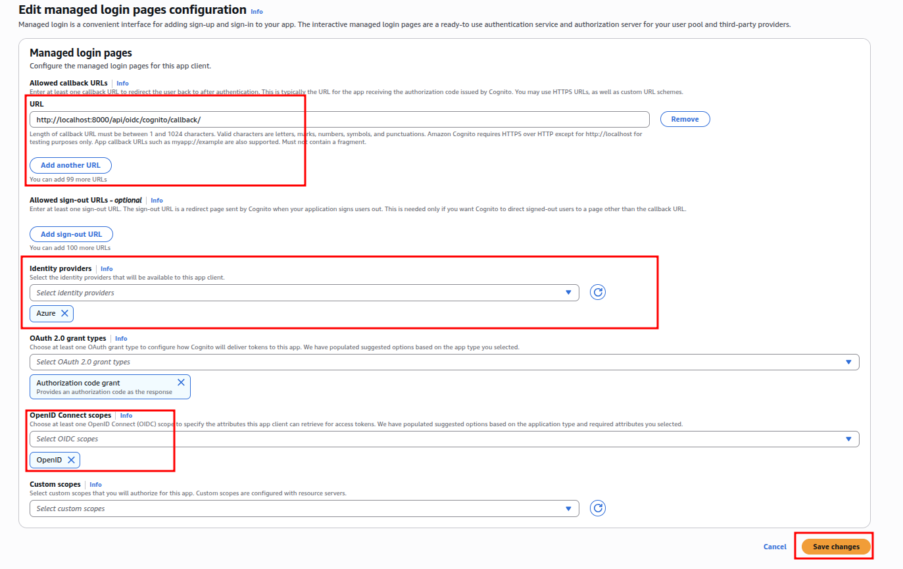

After **custom attributes** setup check in **Attribute Permission** that **Read** and **Write** permissions are checked:

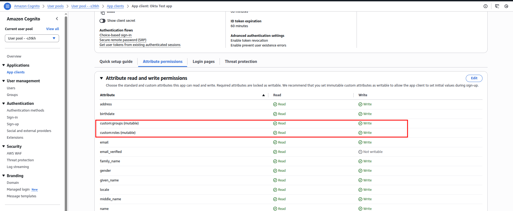

### Step 5: Attach login page to the app client

1. Navigate to **Your User Pool - Managed login.**
2. Click **Create a style** button.

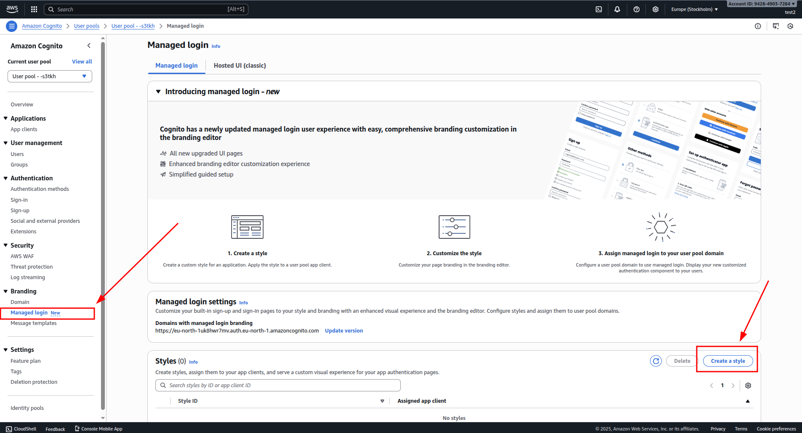

3. Select the **App client** you want to attach a **login page** to.
4. Click **Create.**

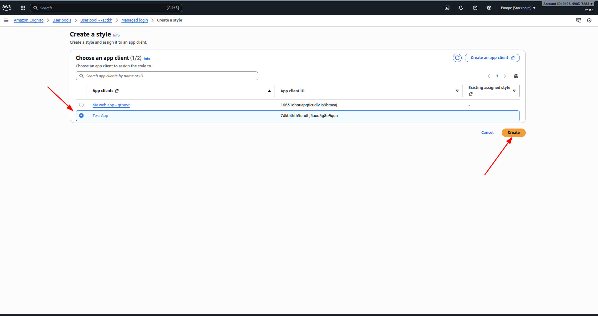

After creation, the login page for your App Client will become available and can be accessed directly via its generated URL.

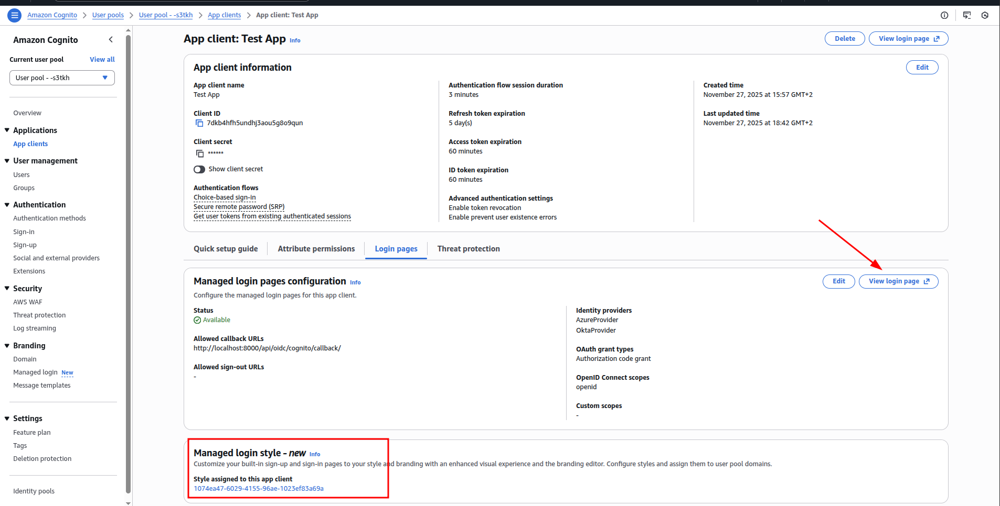

## How to connect to your application

To enable **Cognito login** for your users in **your application**, you need to retrieve the following three parameters:

1. **Client ID**
2. **Client Secret**
3. **User Pool Cognito domain**

You can find this data on our Cognito User Pool and App client pages.

To copy **Client ID** and **Client Secret** Navigate to corresponding **App client:**

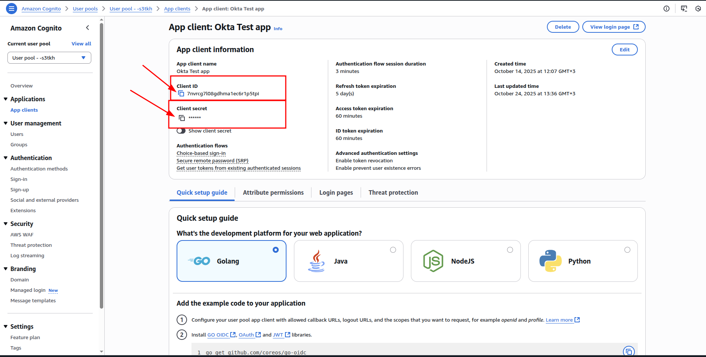

To get User Pool **Cognito domain**, navigate to **Domain** page:

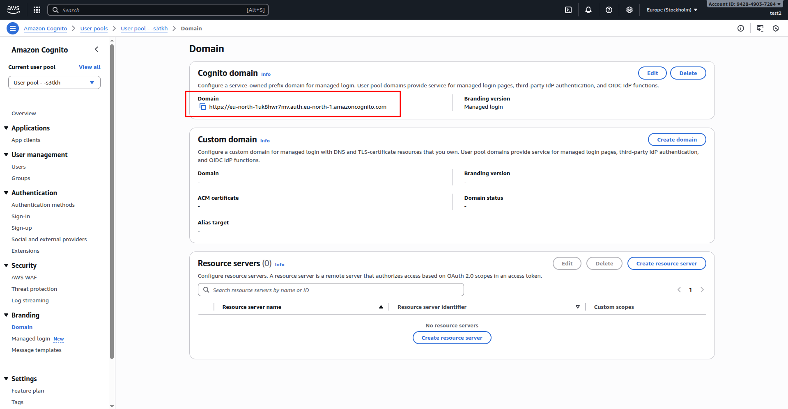

✅ **Cognito Setup Complete.** **Your Cognito configuration is now complete and ready for SSO testing.**
