To enable Single Sign-On (SSO) for your application, we first need to register it in **Azure Active**  

Navigate to Microsoft Entra ID:


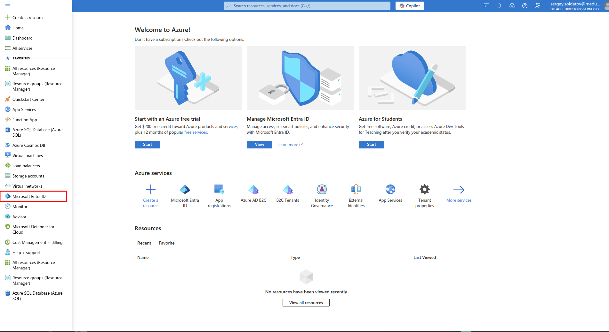

Click to **Add** button and select **App registration**: 


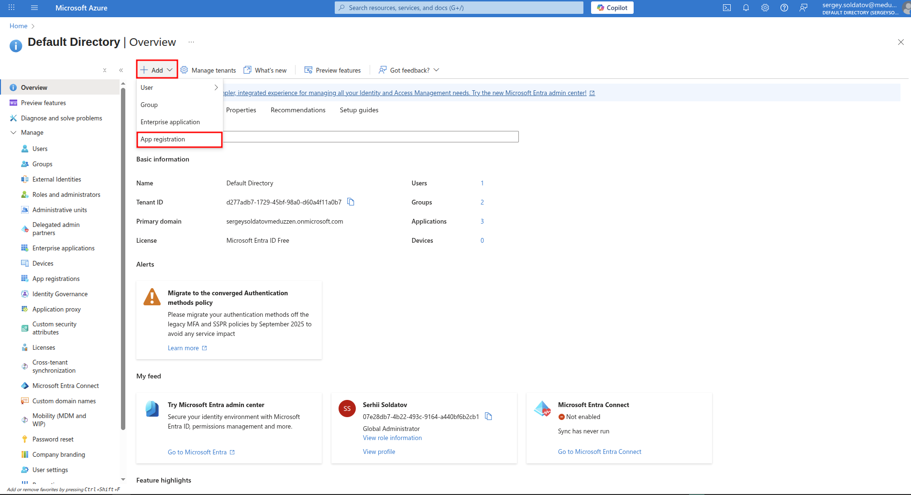
  

Fill in the Name field (you can choose any meaningful name).

Set the **Redirect URI**, which look like this: 

`https://your-user-pool-domain/oauth2/idpresponse ` 
  
where _your-user-pool-domain_ is your Cognito User Pool Domain 

(example: `https://eu-north-asr1mv.auth.eu-north-1.amazoncognito.com/oauth2/idpresponse`).


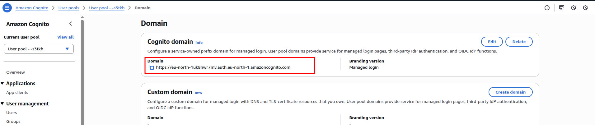

Other fields of this form fill as shown in the following screenshot:


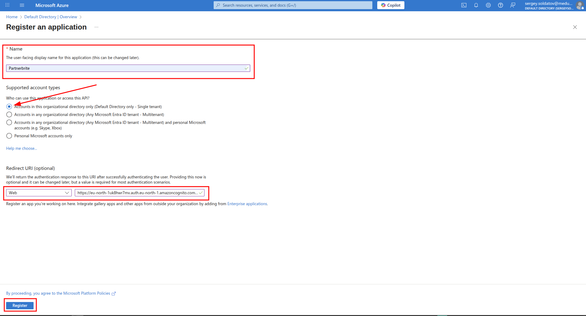

## Configuring logout URL & enabling ID tokens

To complete the authentication setup, we need to:

  1. **Enable ID Tokens** - Since we are using **OpenID Connect (OIDC)** to authenticate users, ID tokens must be enabled.  

  2. **Set the Logout URL** - This ensures users are properly signed out when logging out of our application.

### Steps to configure:

  * Go to **Authentication** in the registered app:  
**Your Azure Active Directory instance** -> **App registrations** -> **< YourApp >** -> **Authentication**  

  * Set the **Logout URL** to:  
[https://your-app-domain/api/oidc/logout](https://your-app-domain/api/oidc/logout)/


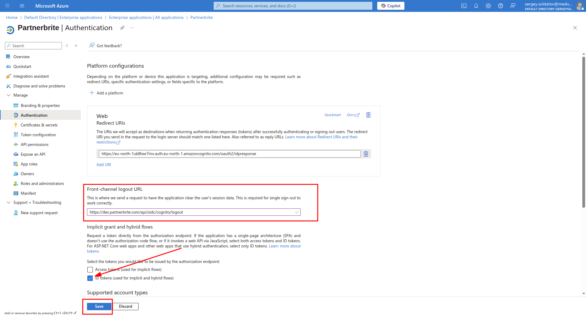

---

## Creating scopes

After creating the application, you will be redirected to the **App Overview** page. Now, let's configure scopes to define the permissions our application can request.

### Step 1: Navigate to Expose an API

Click on **Expose an API**


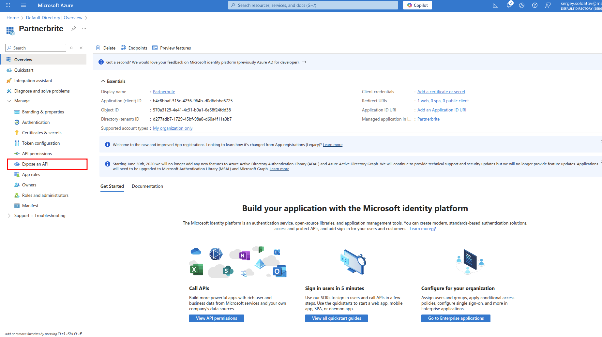

### Step 2: Set application ID URI

If this is your first time accessing this section, you will see a prompt asking you to add an **Application ID URI** before proceeding. This step is required to define unique identifiers for your API.

  * Follow the prompt to add an **Application ID URI (generates automatically)**.


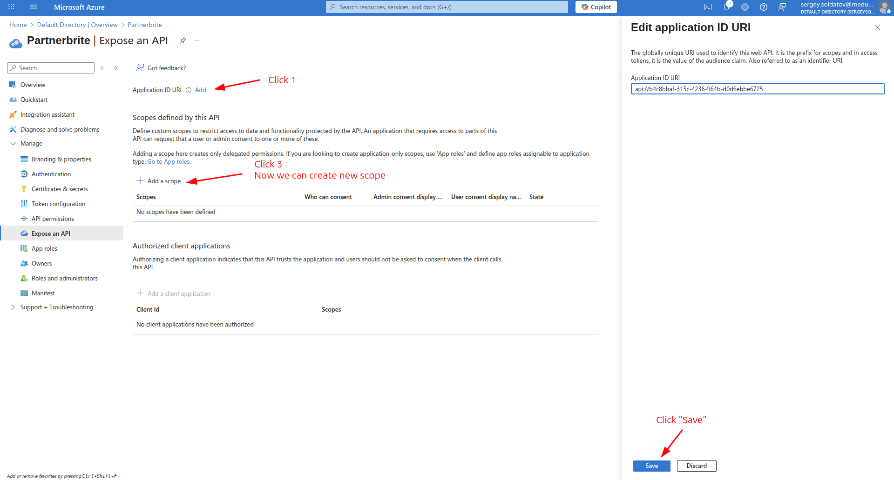

### Step 3: Add a group scope

Now that the **Application ID URI** is set, we can define the scopes our application needs.

  1. Click Add a Scope.
  2. Scopes in **OIDC** determine what permissions the application can request from the identity provider. They allow access to specific user attributes, such as groups, roles, email, or profile information.
  3. In our case, we need the **group** scope to retrieve user groups during authentication. This enables proper access control and permission management in our application.
  4. Fill this form as shown in the following screenshot, then click the **Add scope** button.


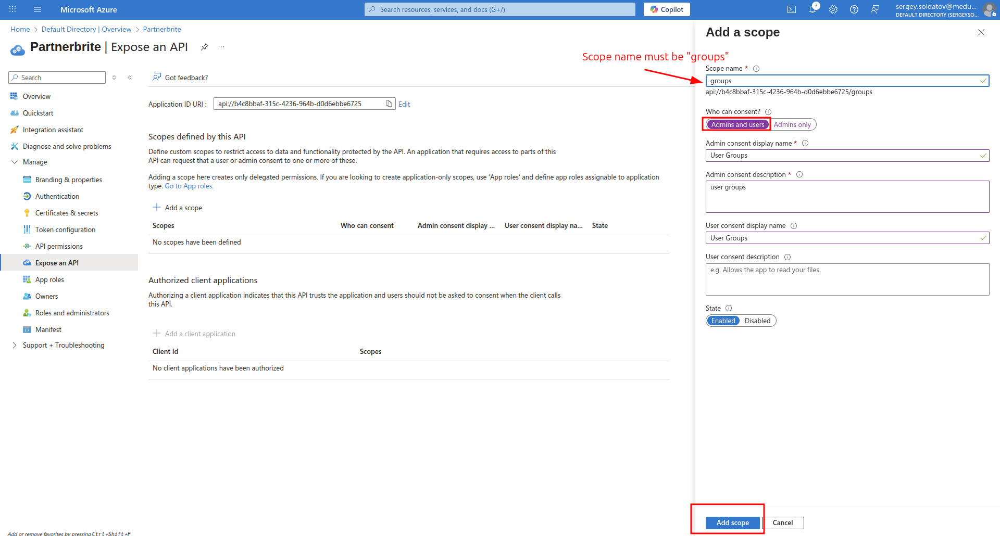

### Step 3.1: Add a roles scope

  1. Click **Add a Scope**.
  2. Scopes in **OIDC** determine what permissions the application can request from the identity provider. They allow access to specific user attributes, such as roles, email, or profile information.
  3. In our case, we need the **roles** scope to retrieve user roles (e.g., admin, manager) during authentication. This enables proper access control and permission management in our application.
  4. Fill this form as shown in the following screenshot, then click the **Add scope** button


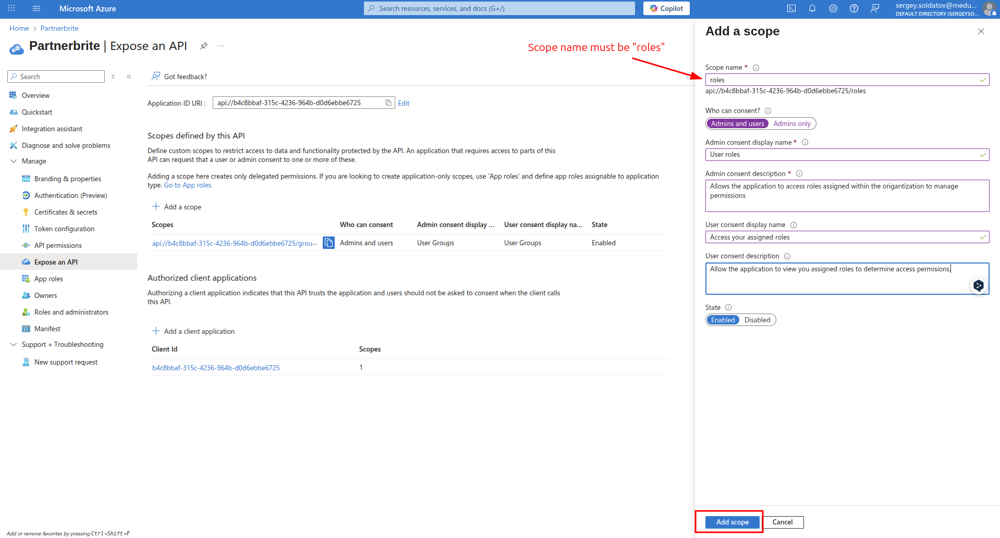

### Step 4: Add a client application

Once the scope is created, we need to associate it with our client application.

  1. Click **Add a client application**.
  2. The **Client ID** can be found in the **Application ID URI**.

With these steps completed, our application is now set up to request and utilize user groups during authentication.


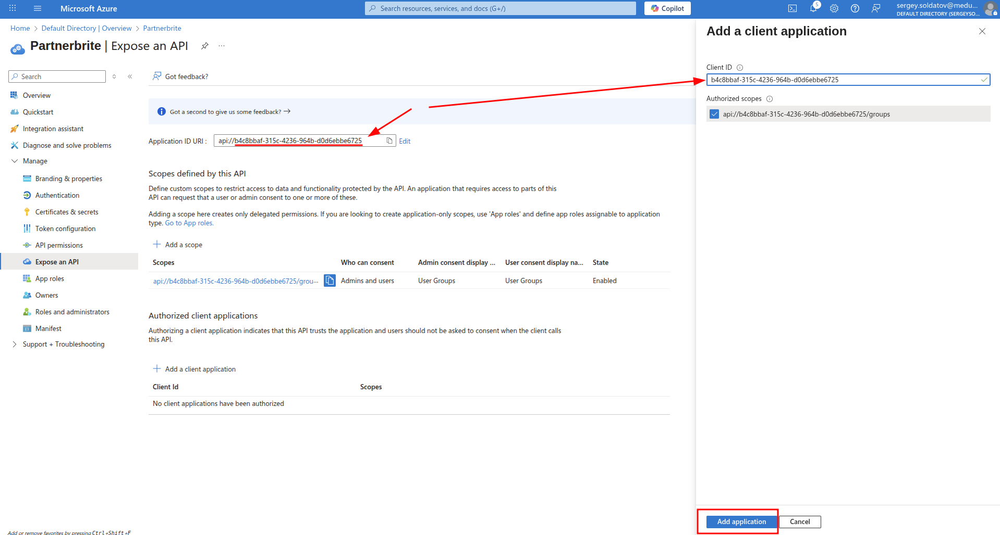

### Step 5: Add a groups to token configuration

After all is created we must create group claim

  1. Click **Add group claim** button.
  2. Fill the form as shown in the following screenshot, then click the **Save** button.


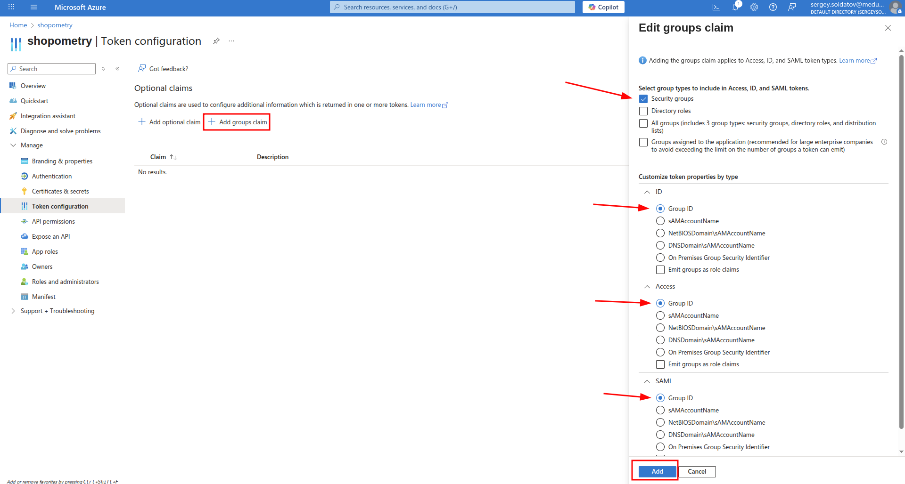

That's it, **the group's** scope and claim is configured.

---

## Extending API permissions

Retrieving the **email**, **openid**, and **profile** claims in the ID token, as well as creating notification subscriptions for soft delete support, requires enabling the appropriate **API permissions**.

  - Navigate to

  **Your Azure Active Directory instance -> App registrations -> < YourApp > -> API Permissions**

  - Click **Add permission**.

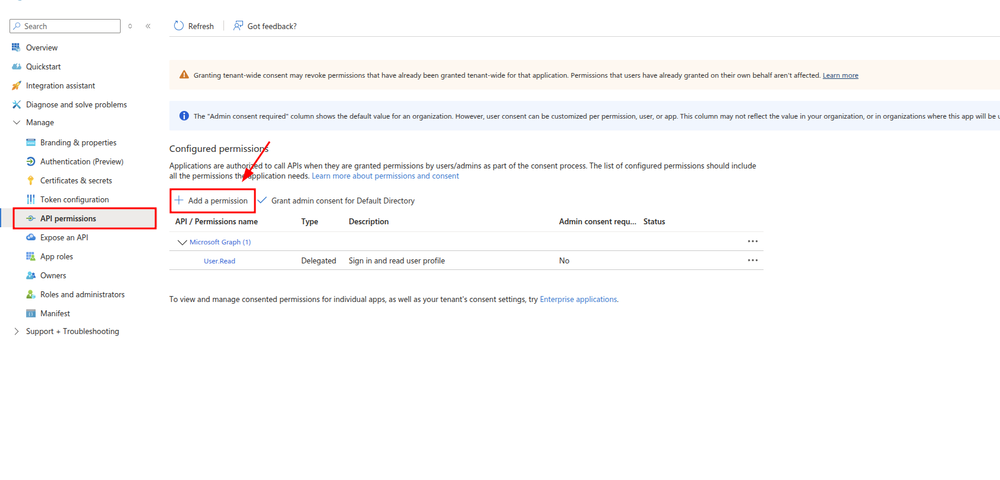

  - In the sidebar that appears, select **APIs my organization uses**, then choose **Microsoft Graph**.  


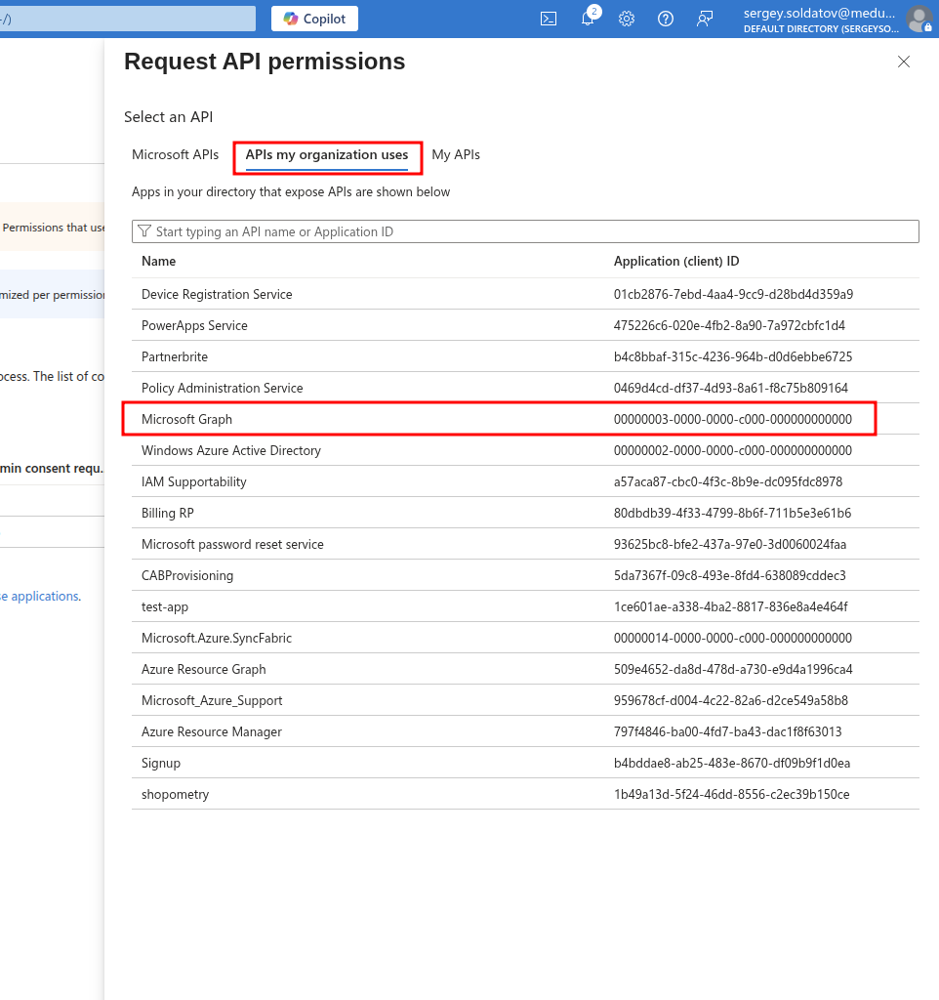

  - Choose **Delegated permissions**, then enable: **email**, **openid**, **profile**, **User.Read**.


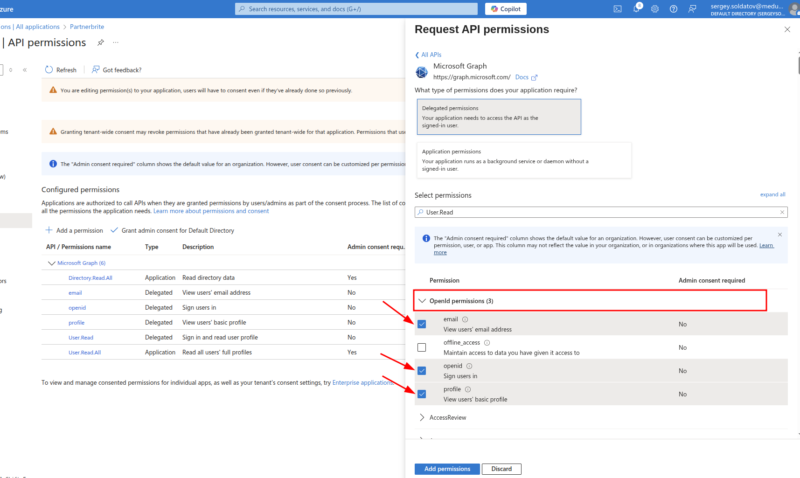


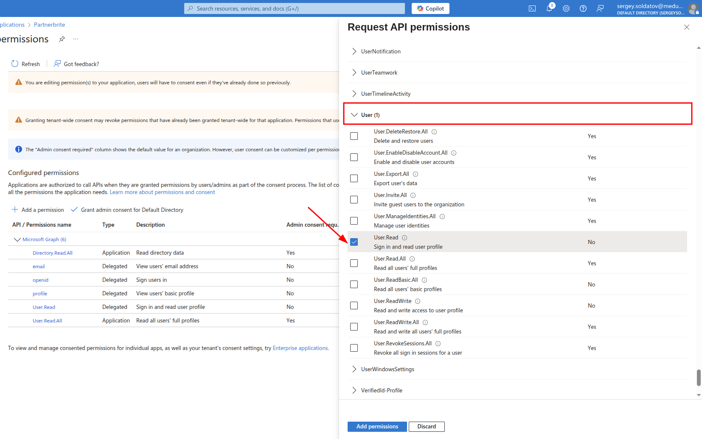

  - Choose **Application permissions**, then enable: **Directory.Read.All** and **User.ReadAll**. Then Click on the **Add permissions** button.


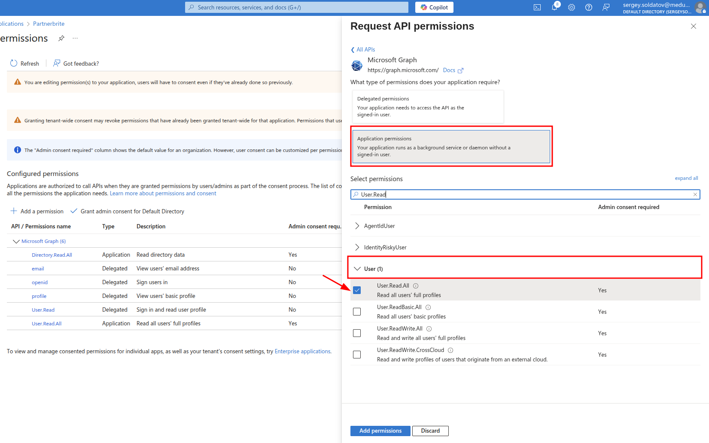


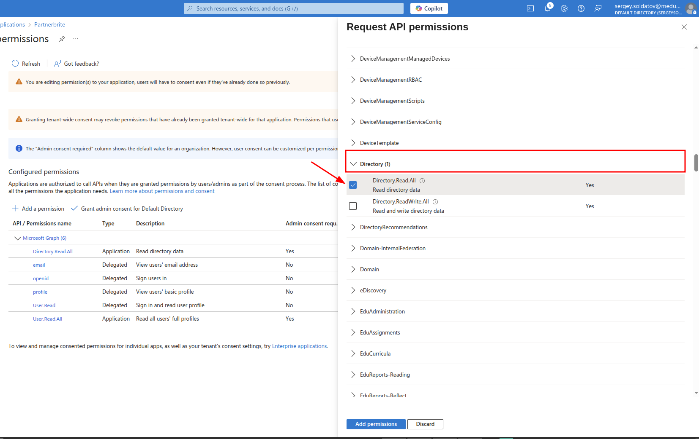

### This is what the correct configuration should look like:


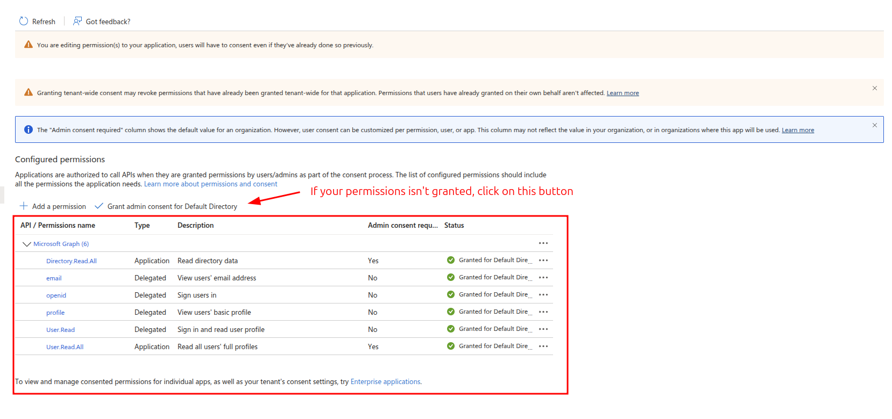

---

## Creating roles

In **Azure Active Directory (AAD)**, we can define roles for users to manage permissions within our application. These roles determine the level of access a user has, such as **admin**, **manager**, etc.  
In the Azure Active Directory we should create roles for users.  
  
**Step 1: Access the Manifest**

To create roles, we need to edit the **application's Manifest**, which is a JSON file defining the application's configuration.

  1. Navigate to:  
**Your Azure Active Directory instance -> App registrations -> < YourApp > -> Manifest**


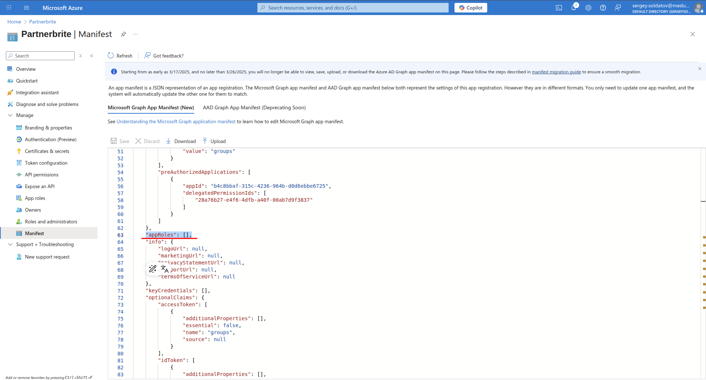

In the **Manifest**, you will find a section for role definitions. If you haven't created any roles yet, this section will be empty (highlighted in red in the screenshot).

  
Example of one role:

```json
{
    "allowedMemberTypes": [
        "User"
    ],
    "description": "Administrators can manage resources.",
    "displayName": "Admin",
    "id": "a1234567-89ab-cdef-0123-456789abcdea",
    "isEnabled": true,
    "origin": "Application",
    "value": "admin"
}   
```
    


**Important**:

  * Each role must have a **unique ID**.
  * Use a **GUID generator** to create unique IDs. You can use this free tool:  
👉[GUID Generator](https://www.guidgenerator.com/)

### Step 2: Add all required roles

For convenience, you can copy and paste the pre-defined role objects into your **Manifest**.

  1. Copy the prepared role definitions.
  2. Replace the role IDs with newly generated GUIDs.
  3. Press the "Save" button to apply the changes.

Once saved, your roles should appear correctly in the Manifest.  
  
_Here's prepared user roles, you can just copy-paste the whole object, BUT do not forget to use your own ids by using GUID, after pasting press "Save" button:_

```json
"appRoles": [
    {
        "allowedMemberTypes": [
            "User"
        ],
        "description": "Full admin access.",
        "displayName": "ADMIN",
        "id": "18846fd3-94e1-4f47-a8e5-27edb66a14b8",
        "isEnabled": true,
        "origin": "Application",
        "value": "admin"
    },
    {
        "allowedMemberTypes": [
            "User"
        ],
        "description": "Booking and campaign management access.",
        "displayName": "MANAGER",
        "id": "b2345678-90ab-cdef-0123-456789abcdeb",
        "isEnabled": true,
        "origin": "Application",
        "value": "manager"
    },
    {
        "allowedMemberTypes": [
            "User"
        ],
        "description": "Booking and campaign management access.",
        "displayName": "REPORT",
        "id": "cd4062ff-2eb9-4960-93c1-1d20637f1d23",
        "isEnabled": true,
        "origin": "Application",
        "value": "report"
    },
]
```

Here's how it should look like:

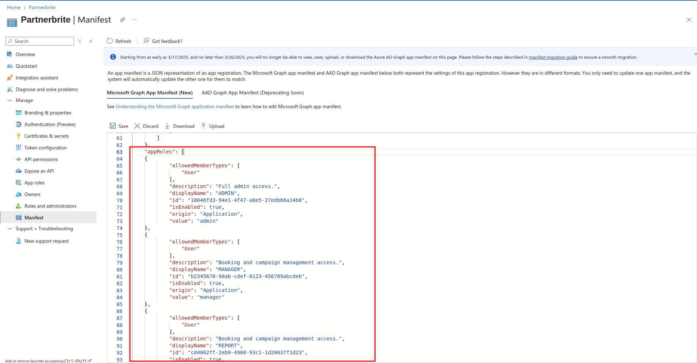

---

## Creating groups

In **Azure Active Directory (AAD)**, we can define groups for users to manage permissions within our application. Groups allow us to control which users have access to the app. A user must be assigned to the appropriate group in order to sign in.
   
**!Note**: If a user is not a member of the group, they will not be able to access your application.  
  
### Step 1: Navigate to groups

To create groups:

  1. Navigate to:  
**Your Azure Active Directory instance -> Groups Manifest**
  2. You should see a screen similar to the one below:
  3. Click the **"New group"** button.


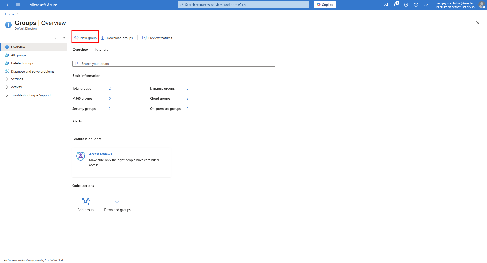

### Step 2: Create group

To create groups:

  1. Choose **Security** type in Group type input
  2. Fill other fields
  3. Click the **"Create"** button. And **Security group** will be created


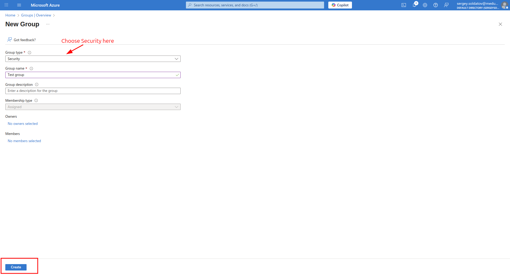

### Step 3: Assign users to group

To assign users to group, follow these steps:

### Step 1: Navigate to group

  1. Go to:  
**Your Azure Active Directory instance -> Groups -> All groups**
  2. Click on the **Group** to which you want to add users.


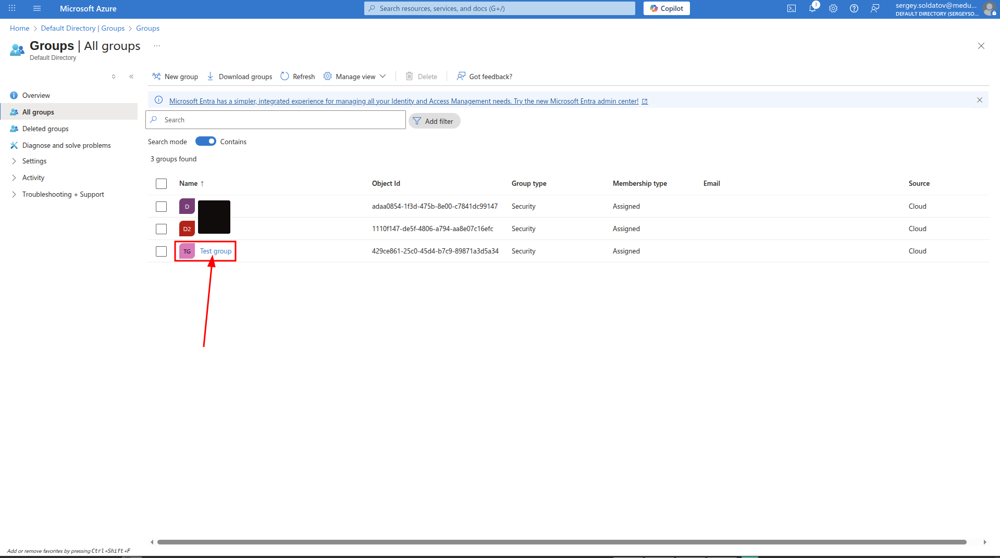


### Step 2: Navigate to members tab

  1. Click the **"Members"** button on the sidebar.


### Step 3: Add members to the groups

  1. Click **Add members**
  2. Select the users you want to add to the group as on the screenshot below.
  3. After you select all users you want to add to the group. Click Select


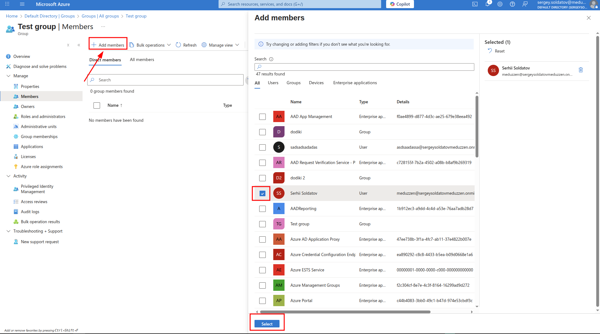

---

## Assigning user roles

To assign roles to users, follow these steps:

### Step 1: Navigate to user role assignment

  1. Go to:  
**Your Azure Active Directory instance -> Enterprise applications -> < YourApp > -> Users and groups**
  2. Click the **"Add user"** button.


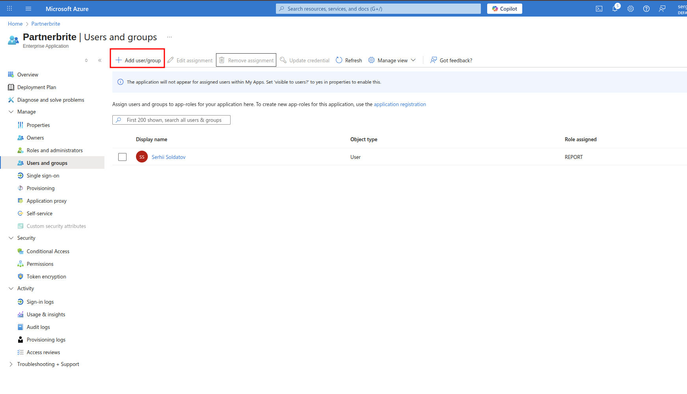

### Step 2: Select users and assign roles

  1. First, select the users you want to assign roles to.  
(See Screenshot below)
  2. On the next screen, choose the appropriate role for the user.
  3. Click **Assign** button


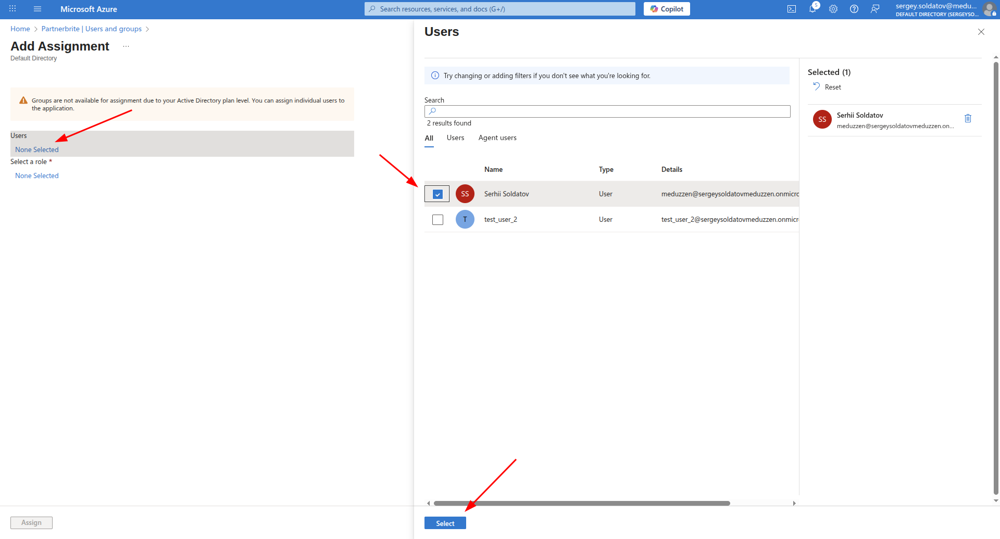


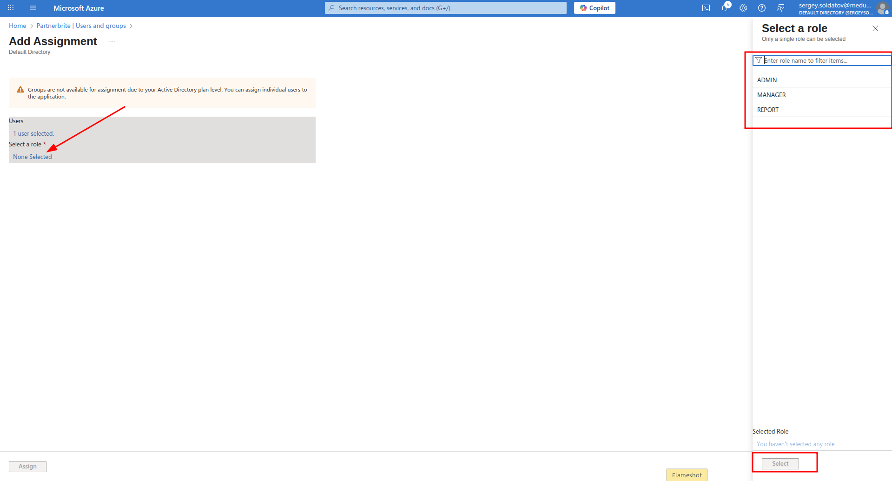

For production environments, it's **not recommended** to assign roles to individual users. Instead, assign roles to **groups** to simplify user management and reduce maintenance efforts.

### Step 3: Confirm role assignment

  1. Click the **"Assign"** button to finalize the role assignment.
  2. You will be redirected to the **Users and groups** view, where you can see the assigned roles.

  

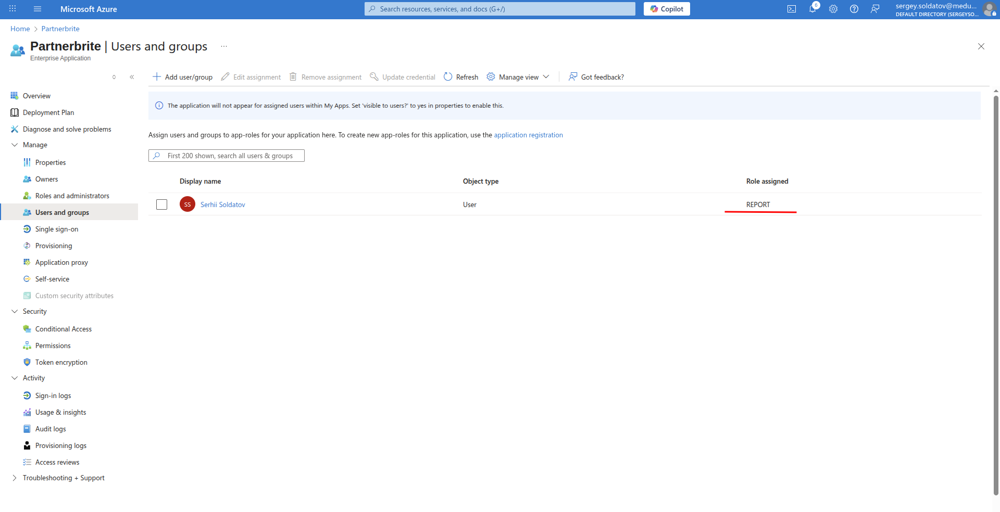
That's it! The Role assignment is now complete.

**Now you have completed all preparation steps and your application is ready to use Azure SSO.**

--- 

## Deleting users

To trigger a **soft-delete** of a user in your application, you need to either remove the user from an Azure group or fully delete the user from Azure IAM.  
  
**Delete user from group:**

To soft-delete a user from all rights holders where the user was, you need to remove the user from the corresponding Azure AD group (the group with the objectId defined in your SSO Client Provider).

### Step 1: Navigate to group

  1. Go to:  
**Your Azure Active Directory instance -> Groups -> All groups**
  2. Click on the **Group** to which you want to delete users.


### Step 2: Navigate to members tab

  1. Click the **"Members"** button on the sidebar.


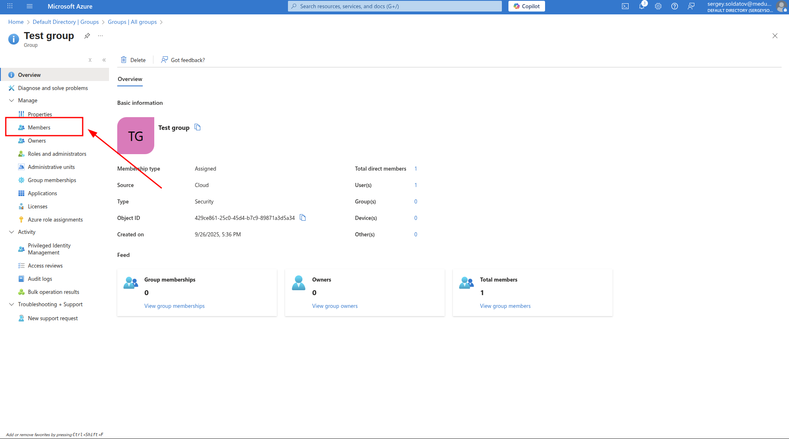

### Step 3: Remove members from the groups

  1. Select the users you want to remove from the group.
  2. After you select all users you want to delete from the group. Click **Remove**.
  3. A modal window will appear with the configuration form. Click **Yes**


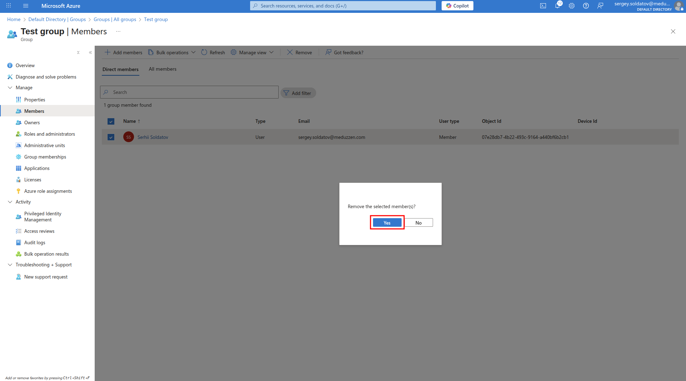

After this, if a member with this ObjectID exists in your application, the system will **soft-delete** the user.

Delete user from IAM: 

### Step 1: Navigate to users page
  1. Go to:  
**Your Azure Active Directory instance -> Users**
  2. Select the users you want to delete.
  3. Click the **"Delete"** button, then confirm by clicking **"Ok"** in the modal window.


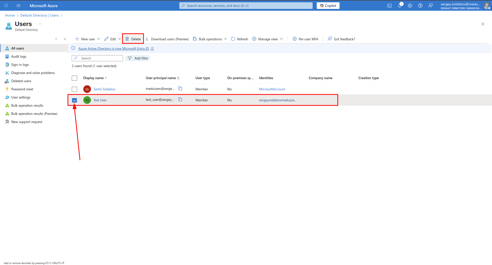


### Step 2: Navigate to deleted users tab
  1. Click the **"Deleted users"** button on the sidebar.


### Step 3: Permanently delete the user
  1. Select the user you delete in **Step 1** or you want to delete.
  2. Click **"Delete permanently"**, then confirm by clicking **"Ok"** in the modal window.


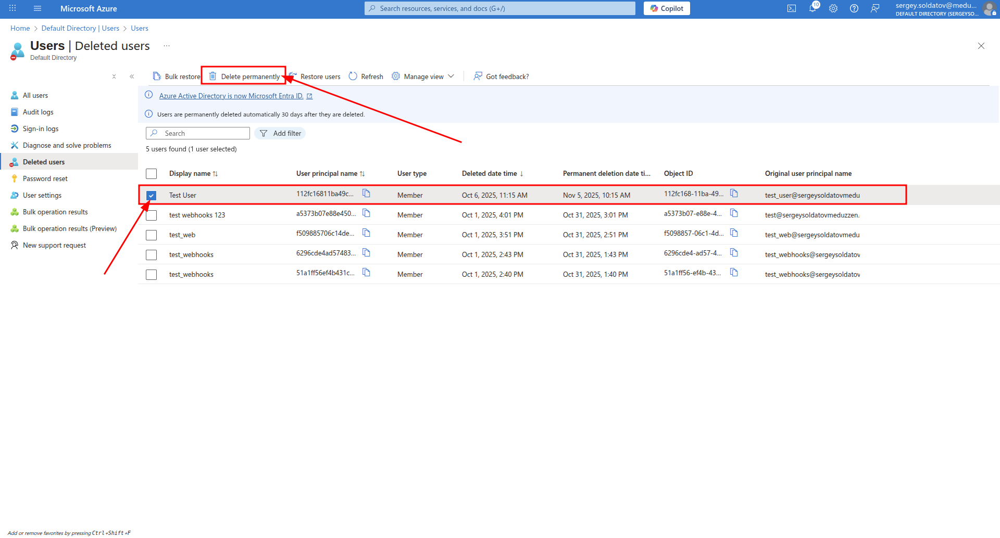


After this, the selected users will be completely deleted from Azure IAM.  
If a user with the same **User ObjectID** exists in your application, that user will also be **soft-deleted**.

**Note:** The User ObjectID is linked to a user in your application only after the user logs in via the Azure SSO Provider.

## (Optional) Multi factor authentication

Multi-Factor Authentication (MFA) adds an additional layer of security to user login. When enabled, users must verify their identity using a second factor, such as the **Microsoft Authenticator app**, in addition to their password.

### Step 1:

  1. Navigate to:  
**Your Azure Active Directory instance -> Properties**
  2. Make sure that Security Defaults are enabled. if not - enable it.


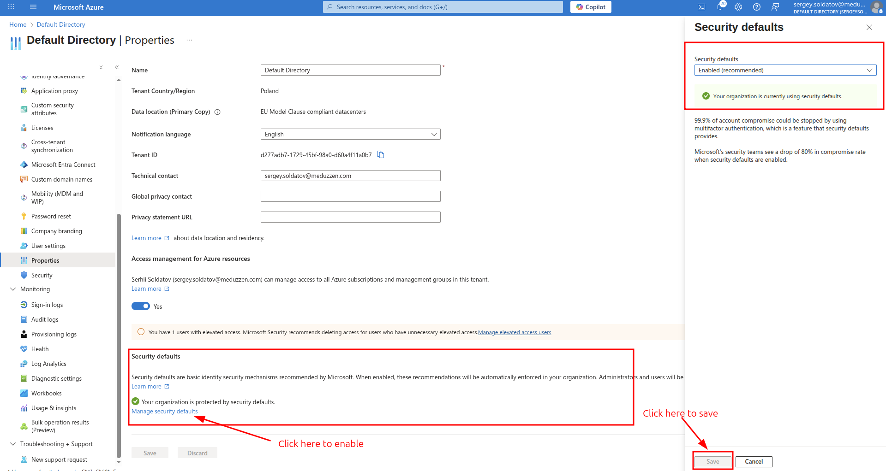

After enabling **Security Defaults**, when a user from your organization attempts to log in, they will be prompted for MFA.

  1. The user will need to use the **Microsoft Authenticator app** (or another supported MFA method) to complete the login.
  2. A screen similar to the one below will appear, guiding the user through the MFA verification process:


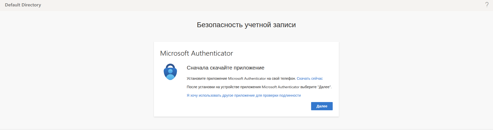

On next login attempts, the user will be required to complete **MFA** using the Microsoft Authenticator app.

---

## How to connect your application

To enable **Azure login** for your users, you need to retrieve the following three parameters:

  1. Client ID
  2. Client Secret
  3. Tenant ID

  
### Step 1: Retrieve client ID & tenant ID

  1. Navigate to:  
**Your Azure Active Directory instance -> App registrations -> < YourApp >**
  2. Locate the **Client ID** and **Tenant ID** in the **App Overview section**.

  

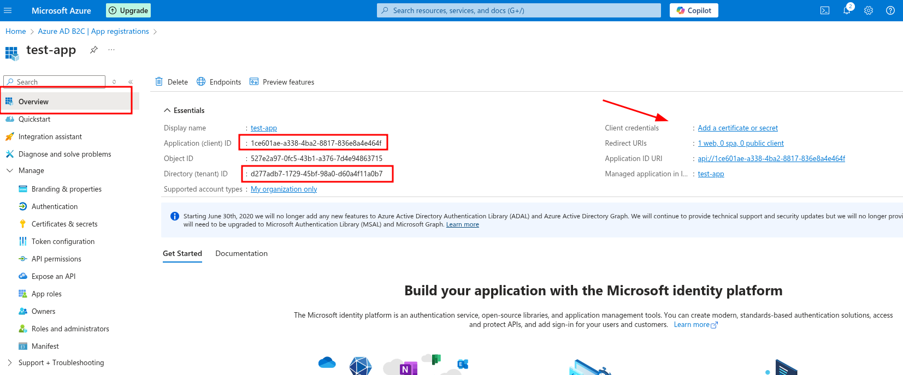 

### Step 2: Generate client secret

  1. Click on **Client credentials** (as shown in Screenshot above).
  2. Create a new **Client Secret**.  
(See Screenshot below)
  3. After creating the secret, **copy the "Value" immediately**, as it will no longer be visible once you refresh or leave the page.

  

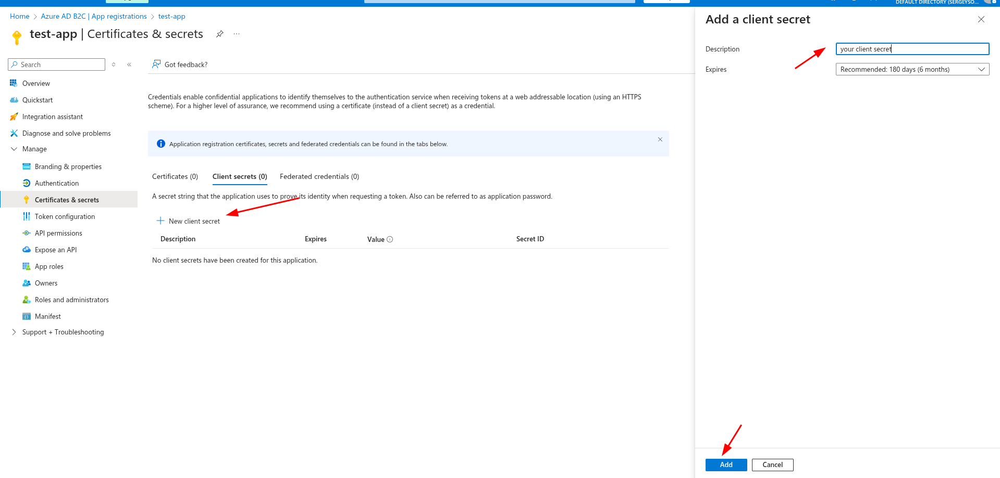

After creation you should copy Value  
Note! after updating page it won't be visible anymore


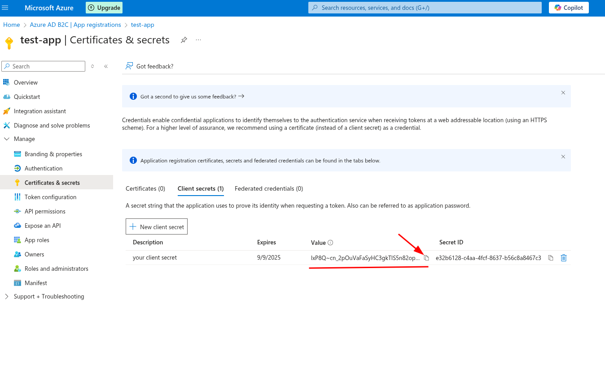

### Copy a issuer URL

Reference:[ ](https://learn.microsoft.com/en-us/entra/identity-platform/v2-protocols-oidc#find-your-apps-openid-configuration-document-uri)[https://learn.microsoft.com/en-us/entra/identity-platform/v2-protocols-oidc#find-your-apps-openid-configuration-document-uri](https://learn.microsoft.com/en-us/entra/identity-platform/v2-protocols-oidc#find-your-apps-openid-configuration-document-uri)

To obtain the Issuer URL for your application, copy: [https://login.microsoftonline.com/{tenant}/v2.0](https://login.microsoftonline.com/%7Btenant%7D/v2.0) and replace **{tenant}** with your application's **tenant ID**.


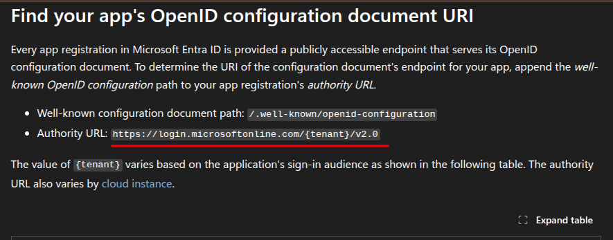


✅ Now you have all the required credentials to configure Azure SSO for your application!
