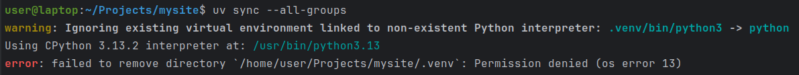
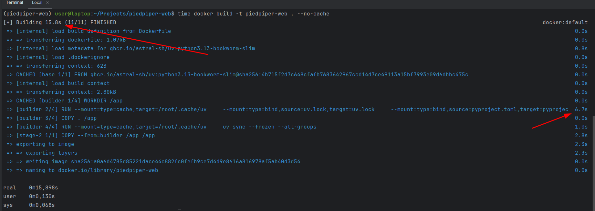
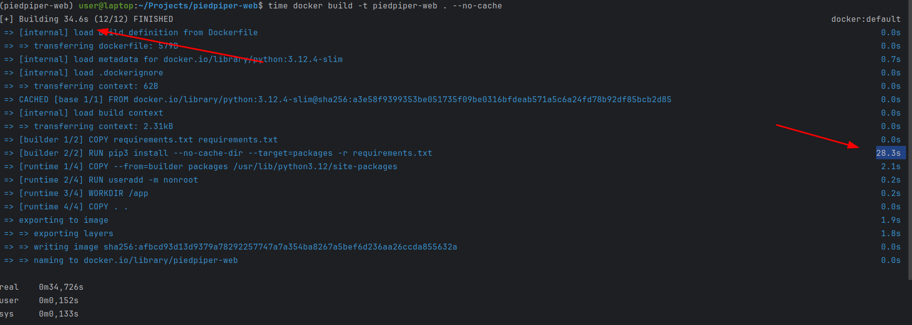

## What's uv?
**UV** is an ultra-fast Python package manager written in Rust by the [Astral team](https://github.com/astral-sh).
You might already be familiar with another great product from Astral - [ruff](https://github.com/astral-sh/ruff) _(popular Python linter)_.

It drastically reduces dependency installation time and produces smaller, optimized Docker images—ideal for enhancing your Django project's Docker workflow.
Let's dive in!

## Quick start
Follow these simple steps to get your local environment ready:
```bash
uv venv    # 1. Create a UV Virtual Environment
source .venv/bin/activate    # 2. Activate the Virtual Environment
uv sync --all-groups    # 3. Install Project Dependencies
docker-compose up --build
```
**Note:** This installs both **production** and **development** dependencies.
Use `uv sync --no-dev` if you want **production-only** packages.

## Dockerfile

Here's a breakdown of a Dockerfile designed specifically for Django applications using UV to manage Python dependencies:

```dockerfile
FROM ghcr.io/astral-sh/uv:python3.13-bookworm-slim AS base
FROM base AS builder

# Set up environment
ENV PYTHONDONTWRITEBYTECODE=1 \
    PYTHONUNBUFFERED=1 \
    UV_COMPILE_BYTECODE=1 \
    UV_LINK_MODE=copy

WORKDIR /app

# Install the project's dependencies using the lockfile and settings
RUN --mount=type=cache,target=/root/.cache/uv \
    --mount=type=bind,source=uv.lock,target=uv.lock \
    --mount=type=bind,source=pyproject.toml,target=pyproject.toml \
    uv sync --frozen --no-install-project --all-groups

# Then, add the rest of the project source code and install it
# Installing separately from its dependencies allows optimal layer caching
COPY . /app
RUN --mount=type=cache,target=/root/.cache/uv \
    uv sync --frozen --all-groups

FROM base
COPY --from=builder /app /app
ENV PATH="/app/.venv/bin:$PATH"
EXPOSE 8000

CMD ["uv", "run", "python", "manage.py", "runserver", "0.0.0.0:8000"]
```

## Base image
We start by leveraging a slim Python image **with UV pre-installed**, optimized for minimal size and maximum speed.

```dockerfile
FROM ghcr.io/astral-sh/uv:python3.13-bookworm-slim AS base
FROM base AS builder
```

## Environment setup
`PYTHONDONTWRITEBYTECODE` prevents Python from writing .pyc files to disk.

`PYTHONUNBUFFERED` ensures immediate logging output.

`UV_COMPILE_BYTECODE` compiles Python bytecode for faster startup.

`UV_LINK_MODE=copy` configures UV to copy dependencies instead of symlinking (improving compatibility).

`UV_PROJECT_ENVIRONMENT` sets the virtual environment path.

**!Permission denied issue**:
You might encounter permission issues when using the default virtual environment paths provided by UV as and I faced:



You can handle this issue in two ways:
1. _(Recommended)_
By adding second volume entry(`/app/.venv`) in your docker-compose file.
Since the `.venv` directory in the container is now completely isolated from your host filesystem and Docker can't change ownership or permissions on your local `.venv` folder, which solves your permission issues.

2. By explicitly setting `UV_PROJECT_ENVIRONMENT` to a dedicated path (/app/venv), we create a clean separation from default or locally-created environments, effectively resolving permission conflicts.

## Dependency installation (optimized caching)
_This example is adapted from the official UV example: [Dockerfile](https://github.com/astral-sh/uv-docker-example/blob/main/Dockerfile)_
```dockerfile
RUN --mount=type=cache,target=/root/.cache/uv \
    --mount=type=bind,source=uv.lock,target=uv.lock \
    --mount=type=bind,source=pyproject.toml,target=pyproject.toml \
    uv sync --frozen --no-install-project --all-groups
```
UV installs dependencies from `pyproject.toml` and `uv.lock`. 

⚠️ **Important:**
Here, I've used `--all-groups` to install every dependency group defined in `pyproject.toml` (including development dependencies like linting tools). For production builds, consider switching to `--no-dev` to install only production dependencies. For detailed guidance on managing dependency groups, refer to the official Dependency [Groups documentation](https://docs.astral.sh/uv/concepts/projects/dependencies/#dependency-groups).

## Adding project source and finalizing installation
```dockerfile
COPY . /app
RUN --mount=type=cache,target=/root/.cache/uv \
    uv sync --frozen --all-groups
```
**!Note:** I've also used `--all-groups` in there.
By adding your project's source after installing dependencies, Docker efficiently caches layers, speeding up rebuilds when code changes occur.

## Final runtime stage
```dockerfile
FROM base
COPY --from=builder /app /app
ENV PATH="/app/venv/bin:$PATH"
EXPOSE 8000

CMD ["uv", "run", "python", "manage.py", "runserver", "0.0.0.0:8000"]
```
In this final image:
✅ Only the necessary files and pre-installed dependencies are copied from the builder stage.
✅ Django runs within UV's isolated virtual environment.


⚠️ **Important Considerations:**

- **Production Use**:
This setup uses Django’s built-in development server (`runserver`). For production environments, consider switching to a production-grade server like `gunicorn` or `uvicorn`.
- **Running Commands with UV**:
After configuring your virtual environment with UV, you **MUST** prefix your commands with `uv run`, e.g.:
```bash
uv run python manage.py ...
uv run pytest -s -v
```
Otherwise, commands executed outside UV's context will fail.

Here's how can look like your `start.sh`:
```bash
#!/usr/bin/env bash

set -o errexit
set -o pipefail
set -o nounset
set -o xtrace

uv run wait_for_postgres.py

uv run manage.py migrate
uv run manage.py runserver 0.0.0.0:8000
```
Your optimized Dockerfile is now ready, resulting in faster builds, smaller images, and better caching strategies for your Django application.

Here's quick time comparison:







With the optimized Dockerfile, the build process completed in just 15.8s, with only 6.7s dedicated to installing dependencies.
In contrast, the previous Dockerfile took 34.6s, spending 28.3s installing dependencies.

You can easily measure this improvement yourself by running:
```bash
time docker build -t container-name . --no-cache
```

And finally, here's an example of `pyproject.toml` and `docker-compose.yml` part:
```toml
[project]
name = "piedpiper-web"
version = "0.1.0"
description = "Piedpiper web"
readme = "README.md"
requires-python = ">=3.13"

# Core application dependencies
dependencies = [
    "boto3~=1.37",
    "dj-database-url==2.3.0",
    "dj-rest-auth==7.0.1",
    "django==5.1.7",
    "django-allauth==65.3.0",
    "django-autoslug==1.9.9",
    "django-configurations==2.5.1",
    "django-cors-headers==4.7.0",
    "django-filter==25.1",
    "django-model-utils==5.0.0",
    "django-role-permissions==3.2.0",
    "django-storages==1.14.5",
    "django-unique-upload==0.2.1",
    "djangorestframework==3.15.2",
    "djangorestframework-api-key==3.0.0",
    "djangorestframework-simplejwt==5.5.0",
    "gunicorn==23.0.0",
    "pillow~=11.1",
    "psycopg2-binary==2.9.10",
    "python-dotenv==1.0.1",
    "requests==2.32.3",
    "setuptools==77.0.3",
]

[dependency-groups]
# Linting and code quality dependencies
lint = [
    "black==25.1.0",
    "flake8==7.1.2",
    "isort==6.0.1",
    "pre-commit==4.2.0",
    "ruff==0.11.2",
]

# dev dependencies
dev = [
    "django-silk>=5.3.2",
    "nplusone>=1.0.0",
    "ipdb==0.13.13",
    "ipython==8.34.0",
    "mock==5.2.0",
    "coverage~=7.7",
    "pytest-django==4.10.0",
    "factory-boy==3.3.3"
    "drf-yasg~=1.21",
]
```

`docker-compose`:
```yaml
  web:
    restart: always
    build:
      context: .
      dockerfile: Dockerfile
      target: builder
    command: bash scripts/start.sh
    working_dir: /app
    volumes:
      - ./:/app
      - /app/.venv
    ports:
      - "8000:8000"
    depends_on:
      - postgres
    env_file:
      - .env
```

## More resources
- [Official documentation](https://docs.astral.sh/uv/)
- [uv: An In-Depth Guide to Python's Fast and Ambitious New Package Manager](https://www.saaspegasus.com/guides/uv-deep-dive/)
- [Best practice Dockerfile for Python with uv](https://depot.dev/docs/container-builds/how-to-guides/optimal-dockerfiles/python-uv-dockerfile)


Hope it was useful,
Thanks for reading 🙌
