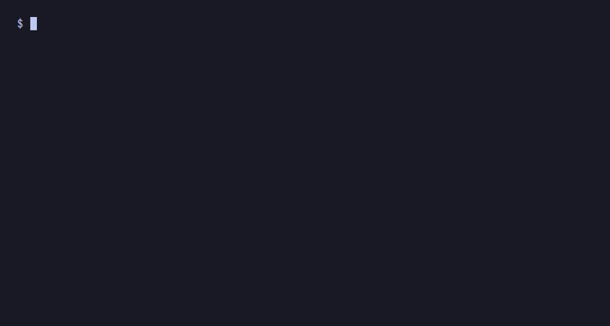

Django technically ships with a bash completion script — it lives in `extras/django_bash_completion`. But nothing wires it up when you `pip install django`. You have to find it, source it manually, and once you do, it completes command names and flags. That's it.

App labels? Migration names? No.

This has been an open issue since [ticket #1240](https://code.djangoproject.com/ticket/1240), filed in 2006.
The discussion already identified app-name completion as the tricky part.
Twenty years later it still isn't in core.

I built [django-completion](https://github.com/soldatov-ss/django-completion) to fix it. This article covers that.

---

## The daily friction

The thing that bothered me wasn't forgetting command names. It was the two steps right after:

```bash
python manage.py migrate acc<Enter>           # too early — typo
python manage.py migrate accounts 0003<Tab>  # what's the exact filename?
```

Guessing migration names is the worst. They follow a pattern
(`0003_add_user_profile`) but you have to check the filesystem or run `showmigrations` first. Either way, you've left the flow.

---

## Why argparse completion doesn't reach this

Tools like [argcomplete](https://github.com/kislyuk/argcomplete) or Django's own `django_bash_completion` parse the command's argparse definition and surface flags: `--verbosity`, `--settings`, `--no-input`, etc.

What they can't surface is positional arguments that come from *your project* — app labels, migration names, test module paths. Those aren't declared in argparse. They're discovered at runtime by loading `DJANGO_SETTINGS_MODULE` and calling `django.setup()`, which initializes the full app registry.

Doing that on every keypress is the wrong tradeoff. On a medium-sized project, `django.setup()` takes 200–500ms. That's noticeable as input lag, and the approach doesn't compose well with virtual environments or `uv`.

---

## What django-completion does differently




Instead of loading Django at completion time, the approach is inverted:

**Discovery happens after commands run, not when Tab is pressed.**

After any `manage.py` command finishes, django-completion rebuilds a small JSON cache at your project root. Tab completion reads that file. No Django import, no database access, no perceptible delay.

---

## Install

```bash
pip install django-completion
```

Add to `INSTALLED_APPS`:

```python
INSTALLED_APPS = [
    # ...
    "django_completion",
]
```

Run once to wire up the shell script:

```bash
python manage.py autocomplete install
```

Restart your terminal. Tab works.

All common invocation forms are covered:

```bash
manage.py migrate <TAB>
./manage.py migrate <TAB>
python manage.py migrate <TAB>
python3 manage.py migrate <TAB>
uv run python manage.py migrate <TAB>
```

---

## How it works

After any management command finishes, `AppConfig.ready()` has patched `BaseCommand.execute` to spawn a background thread that rebuilds the cache if it's stale. The patch looks like this:

```python
def patched(cmd_self, *args, **kwargs):
    try:
        return original_execute(cmd_self, *args, **kwargs)
    finally:
        thread = threading.Thread(target=maybe_refresh_cache)
        thread.start()
```

The thread writes `.django-completion-cache.json` to `BASE_DIR` — command names, app labels, per-command flags, migration filenames. A 60-second cooldown prevents redundant rebuilds when you run several commands in a row. The cache refresh doesn't block your command at all.

When you press Tab, the shell reads that file and passes the current line to a small Python helper that applies a declarative rule table:

```python
_COMMAND_RULES = {
    "migrate":        CommandRule(pos2="migration_apps",  pos3="migration_names"),
    "showmigrations": CommandRule(pos2="migration_apps",  pos3="options"),
    "makemigrations": CommandRule(pos2="local_apps",      pos3="options"),
    "sqlmigrate":     CommandRule(pos2="migration_apps",  pos3="migration_names_no_zero"),
    "dumpdata":       CommandRule(pos2="all_apps",        pos3="options"),
    "test":           CommandRule(pos2="all_apps",        pos3="options"),
}
```

`migrate` at position 2 gets app labels filtered to those that have migrations. At position 3 it gets migration names for the app already typed, plus `zero`. A word starting with `-` always triggers flag completion. Commands not in the table fall back to flags only — a safe default for custom management commands.

Two smaller details worth naming: the shell script walks up from `$PWD` to find the cache file, so completion works from any subdirectory in your project. And `makemigrations` only surfaces *local* apps — ones inside `BASE_DIR` — so `django.contrib.admin` and friends don't clutter the list.

---

## What's next

- **Fish shell** — the completion API is different from bash/zsh; the cache format is stable if anyone wants to write a Fish module
- **PowerShell** — out of scope for me personally, same offer
- **Fuzzy matching** — there's a stub in the codebase; not shipped yet

---

## Try it

```bash
pip install django-completion
```

- GitHub: [github.com/soldatov-ss/django-completion](https://github.com/soldatov-ss/django-completion)
- Docs: [soldatov-ss.github.io/django-completion](https://soldatov-ss.github.io/django-completion)
- PyPI: [pypi.org/project/django-completion](https://pypi.org/project/django-completion)

If it breaks on your setup — unusual `BASE_DIR`, custom `MIGRATION_MODULES`, monorepo layout — open an issue. Those edge cases are the interesting ones.

If it works, a ⭐ on GitHub helps other Django developers find it.
