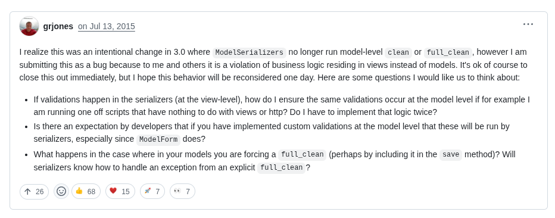

The GitHub Discussion: [link](https://github.com/encode/django-rest-framework/discussions/7850)




## Issue developers face:

When developing with Django REST Framework (DRF), developers typically run into issues where error messages for custom validation specified on Django model constraints (e.g., UniqueConstraint.violation_error_message) are not passed through to API responses. DRF returns default validation error messages instead.

For example, a custom error message like:
```python
UniqueConstraint(
    fields=['email', 'username'],
    violation_error_message='This email and username combination already exists.'
)
```
...might never actually reach the API client.

Instead, you'll see something generic like:
```json
{"non_field_errors": ["The fields email, username must make a unique set."]}
```

This is what the DRF maintainers had to say about it:

- DRF validation is deliberately occurring at the serializer level, **before** the creation of the model instance.

- It intentionally avoids calling Django's `full_clean()` in this processes, as serializers are meant to validate incoming data instead of an already-created model instance.

- Due to the complexity and backward compatibility issues, there are no immediate plans from DRF for changing this behavior.

In other words - DRF prioritises serialiser checking for API input, which means that unless you explicitly call model checking (e.g. via `full_clean()`), constraint errors and their custom messages will never be called or shown in API responses.


## Possible solutions:

Developers can tackle this issue through several practical approaches:

- **Explicitly calling `full_clean()`:**
```python
def create(self, validated_data):
    instance = MyModel(**validated_data)
    try:
        instance.full_clean()
    except DjangoValidationError as e:
        raise DRFValidationError(e.message_dict)
    instance.save()
    return instance
```

- **Custom serializer validators:**

This method just overrides DRF's built-in UniqueTogetherValidator just to replace the error message.

```python
class CustomUniqueValidator(UniqueTogetherValidator):
    def __call__(self, attrs, serializer):
        try:
            super().__call__(attrs, serializer)
        except serializers.ValidationError:
            raise serializers.ValidationError("This email and username combination already exists.")
```

-  **Sometimes just double your validation code:**
Sometimes, custom validators and extra abstractions aren't needed. Although we all know the DRY principle, sometimes it's acceptable to just dublicate simple validation logicdirectly into your serializer

```python
class MyModelSerializer(serializers.ModelSerializer):
    class Meta:
        model = MyModel
        fields = ['email', 'username']
        validators = [
            UniqueTogetherValidator(
                queryset=MyModel.objects.all(),
                fields=['email', 'username'],
                message="This email and username combination already exists."
            )
        ]
```


### Summary:

**Issue**: DRF doesn't carry forward any custom validation messages defined in Django.

**Reason**: For reasons of architecture and backward compatibility, DRF validates its data independently from Django's model validation.

### Important warnings:
Be careful where you place validation logic. Django models can be modified via the admin interface, serializers, or directly with bulk operations (.update()).

Placing the critical validation logic into `save()` or `full_clean()` is problematic, as those aren't called when performing bulk updates or certain direct model manipulations. Always bear these edge cases in mind when developing your validation plans.

This approach keeps your validation logic consistent, reusable, and well-documented throughout your project.
