## Prerequisites for all OIDC providers

This guide covers the admin setup for SSO authentication built with Django and AWS Cognito. The full reference implementation is available on GitHub: [django-cognito-sso-demo](https://github.com/soldatov-ss/django-cognito-sso-demo).

---

## How SSO works in this setup

1. The user authenticates via an external OIDC provider (e.g., Azure or Okta)  
2. AWS Cognito federates the identity  
3. Your application validates:
   - group membership  
   - email domain  
4. Access is granted or denied  

---

## Requirements

Before configuring SSO, ensure the following:

1. **Add an OIDC Provider to your Cognito User Pool**  
   - Requires: Client ID, Client Secret, Issuer ID  

2. **Configure the `groups` claim in your OIDC provider**  
   > **Important:** This is required for group validation to function properly  

3. **Add a custom `groups` attribute in Cognito**  
   > **Important:** The attribute name must match the `groups` claim used by your OIDC providers  

---

## Provider setup guides
[Azure Single Sign-On (SSO) Setup: A Step-by-Step Guide](/blog/azure-sso-setup/)
 
[Okta Single Sign-On (SSO) Setup: A Step-by-Step Guide](/blog/okta-sso-setup/)

Other OIDC providers typically follow a similar setup process.

---

## Creating SSO account configuration

After entering the admin panel, find SSO Account Configs under the OIDC Auth application and click Add.

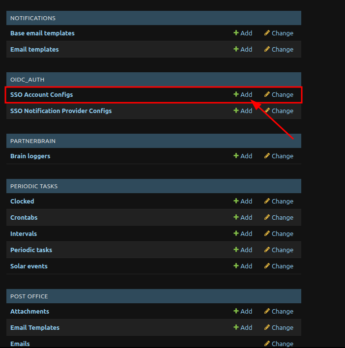

## Setting up SSO account configuration

To configure an SSO Client provider, you need the Client ID, Client Secret from you Cognito App Client, you can copy this in your App Client page.


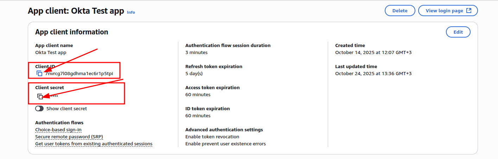

1. Choose your Account.  
   **Important:** Only accounts with the required permissions can be selected in this field by SSO requirements.

2. Enter your application Cognito Client ID, Cognito Client Secret.

3. Enter Provider Names from your Cognito App client, one of the values in this list can be used as `identity_provider` in `/oauth2/authorize` Cognito URI.

4. Enable Is active to activate this provider.

5. Allowed Domains — users whose email domain matches one of these domains will be allowed to access your application via this SSO configuration.

6. Enter the OIDC Provider Groups that should have access your application via this SSO configuration.  
   **Important:** Only users who belong to these groups will be able to sign in.  
   **Warning:** The group name must exactly match the format in your OIDC provider’s ID token.  
   Make sure to check the correct group format (e.g., Okta = group name, Azure = group object ID).

7. Finally, click Save.

Here is an example of a completed form for my Account and Cognito application client.

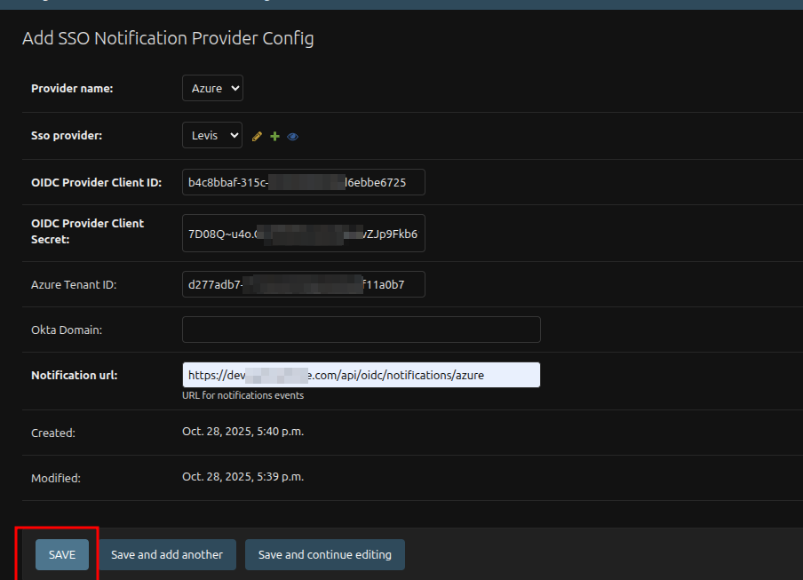

---

## SSO notification configuration

### Azure

To configure SSO Provider Notification Config for Azure, you need the Client ID, Client Secret, and Tenant ID  from your Azure application (copied during the final step of the Azure configuration documentation).

1. Choose Azure as a Provider Name.
2. Choose your Azure SSO Provider.
3. Enter your Azure application Client ID, Client Secret and Tenant ID.
4. Enter Notification url to your application Notification URL Endpoint (in my example it is https://dev.yourapp.com/api/oidc/notifications/azure).
5. Finally, click Save.

---

### Okta

No additional configuration is required if Event Hooks are set up correctly.  
Soft-delete functionality will work automatically.

✅ You have now successfully created SSO Providers in your application and can test it!

---


## Admin API (automating setup)

### POST /api/oidc/cognito/setup/

**Purpose:**

These endpoints automate the setup of SSO in Cognito and your app, reducing manual configuration and ensuring consistent integration between external OIDC providers and Cognito App Clients.

Creates one or more External Identity Providers inside the Cognito User Pool and then creates a Cognito App Client that is linked to all providers specified in the providers field.

!Important: This endpoint requires admin or privileged user access.

**Request fields:**

**`provider`** (required)

An external OIDC provider to create in the Cognito User Pool.

Each provider entry must include:

- client_id - Identity Provider Client ID
- client_secret - Identity Provider Client Secret
- oidc_issuer - Identity Provider Issuer URL

**`group`**

A group name used for group validation during the SSO login flow if the user does not exist in your app.

Make sure to check the correct group format in your provider first (for example, for Okta it’s the group name, while for Azure it’s the group object ID). Otherwise, group validation won’t be working.

**`allowed_domain`**

Users with this email domain will be allowed to access your application via this SSO configuration.


Example request for Okta:

```json
{
    "provider": {
        "client_id": "0oavpnkcas2Otd5s697", // Identity Provider Client ID
        "client_secret": "YRlFfB8wXkEkIasdWlmxC_UQenDNWTbCLmhasdGGBoDKsF00njihZ", // Identity Provider Client Secret
        "oidc_issuer": "https://integrator-2000932.okta.com/oauth2/default"  // Identity Provider Issuer URL (Okta Format)
    },
    "group": "ada2a854-1asdd-475b-8e00-c7841dc99147", // Okta format group
    "allowed_domain": "test-company.com"  // Allowed domain for SSO Provider
}
```

Example Request for Azure AD:

```json
{
    "provider": {
        "client_id": "b4asdaf-315c-4236-964b-d0d6ebbe6725", // Azure App Client ID
        "client_secret": "XOQ8Q~iUoWahILy6mpzIvsoSsGZT7cii", // Azure App Client Secret
        "oidc_issuer": "https://login.microsoftonline.com/d277adb7-1729-42x2-98a0-asda0b7/v2.0"  // Azure App Issuer URL
    },
    "group": "asds2-1f3d-475b-8e00-c7841dc99147", // group fom Azure AD
    "allowed_domain": "test-company.com"  // Allowed domain for SSO Provider
}
```

Possible Errors:

Provider does not exists in User Pool 400:

```json
{
    "status": "failed",
    "message": "Failed to create Cognito client or SSO provider.",
    "error": "{'message': ErrorDetail(string='The provider TestProvider does not exist for User Pool eu-north-1_....', code='cognito_error')}"
}
```


Provider with same name already exists in User Pool 400:

```json
{
    "status": "failure",
    "message": "Failed to create OIDC provider.",
    "error": "{'message': ErrorDetail(string='OktaTestProvider already exists for tenant eu-north-1_....', code='cognito_error')}"
}
```

Successful Response 201:

```json
{
    "status": "success",
    "message": "OIDC provider created successfully."
}
```

---

## Triggering Azure notification events

To trigger a soft-delete of a user in your application, you need to either remove the user from an Azure group or fully delete the user from Azure IAM.

### Delete user from group

To soft-delete a user from all rights holders where the user was, you need to remove the user from the corresponding Azure AD group (the group with the objectId defined in your SSO Client Provider).

**Step 1: Navigate to group**

1. Go to:  
 Your Azure Active Directory instance → Groups → All groups
2. Click on the Group to which you want to delete users.


**Step 2: Navigate to Members tab**

1. Click the “Members” button on the sidebar.


**Step 3: Remove members from the groups**

1. Select the users you want to remove from the group.
2. After you select all users you want to delete from the group. Click Remove.
3. A modal window will appear with the configuration form. Click Yes


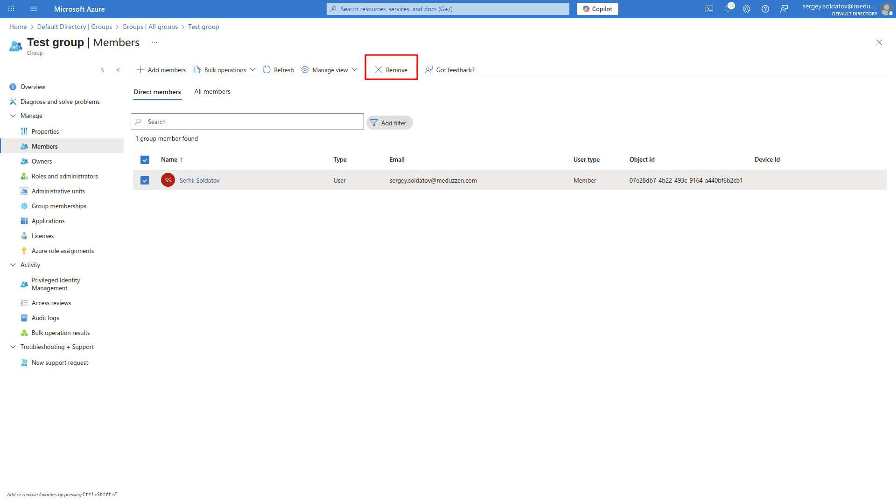


After this, if a member with this ObjectID exists in your app, the system will soft-delete the user.

### Delete user from IAM

**Step 1: Navigate to Users page**

1. Go to:  
 Your Azure Active Directory instance → Users.
2. Select the users you want to delete.
3. Click the “Delete” button, then confirm by clicking “Ok” in the modal window.


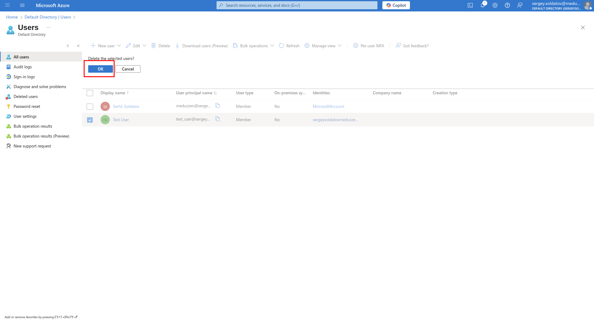

**Step 2: Navigate to Deleted users tab**

1. Click the “Deleted users” button on the sidebar.


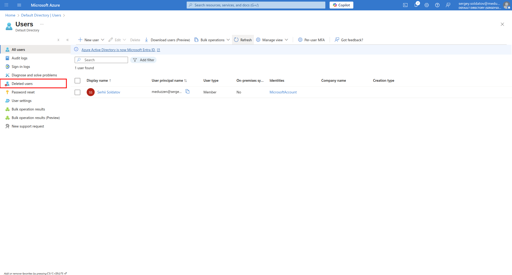

**Step 3: Permanently delete the user**

1. Select the user you delete in Step 1 or you want to delete.
2. Click “Delete permanently”, then confirm by clicking “Ok” in the modal window.


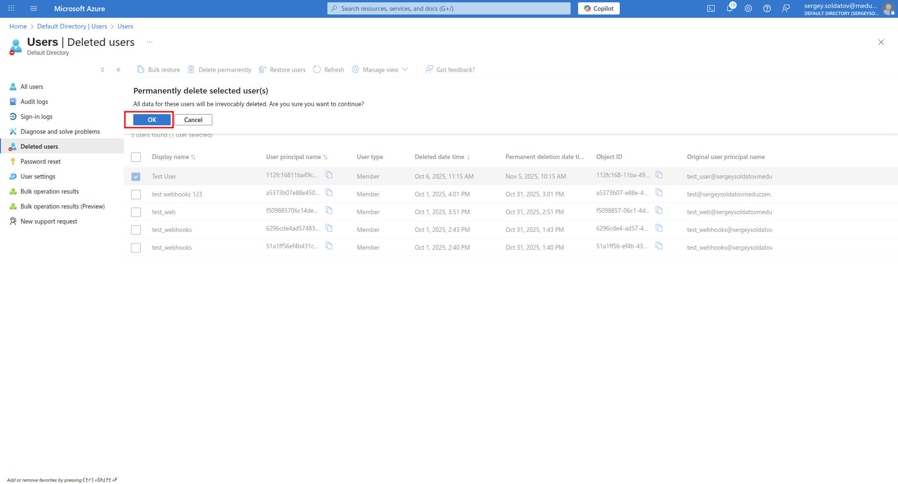

After this, the selected users will be completely deleted from Azure IAM.  
If a user with the same User ObjectID exists in your app, that user will also be soft-deleted from your app.

Note: The User ObjectID is linked to a user in your app only after the user logs into your app via the Azure SSO Provider.

---

## Okta: triggering notification events

To trigger a soft-delete of a user in your application, you need to either remove the user from an Okta group or fully delete the user from Okta IAM.  
  
### Delete user from group

To soft-delete a user from all rights holders where the user was, you need to remove the user from the corresponding Okta group (the group with the Group name defined in your SSO Client Provider).

In the side menu, navigate to the Groups page and click on the group which you want to remove users:


Next to the user you want to remove, click on the cross (x) icon and the user will be removed.


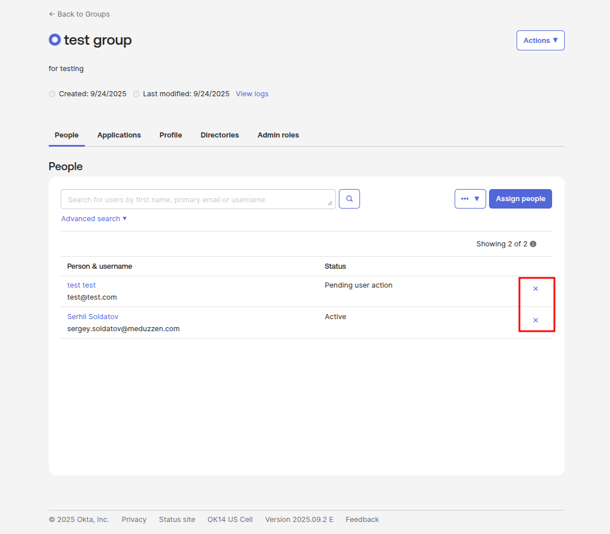

Once the user is removed from the group, they will be soft-deleted in your application.

Note: Users will be removed only when deleted from groups that are present in your app SSO Providers Group name, if not this event hook will be skipped.

### Delete user from IAM

In the side menu, navigate to the People page and select the the user which you want to delete:


You will be redirected to the User Profile page. Click on the More Actions button, then click Deactivate to deactivate the user.


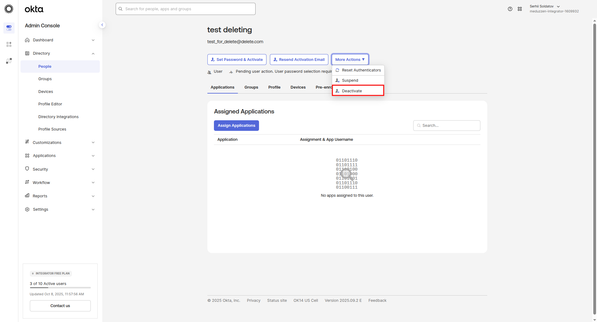

A modal window will appear with. Click Deactivate.

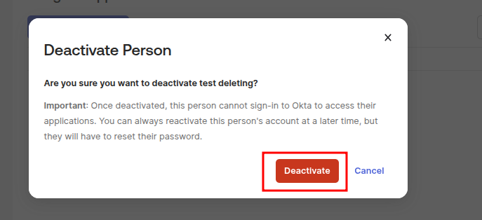

Then after the user deactivated, the Delete button will appear. Click Delete to completely delete the user from IAM.


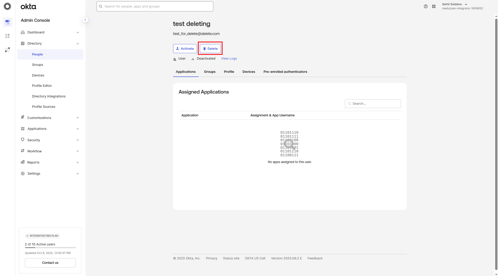

A modal window will appear with. Click Delete.


After this, the selected user will be completely deleted from Okta IAM.

If a user with the same email exists in your application, that user will also be soft-deleted in your application.
