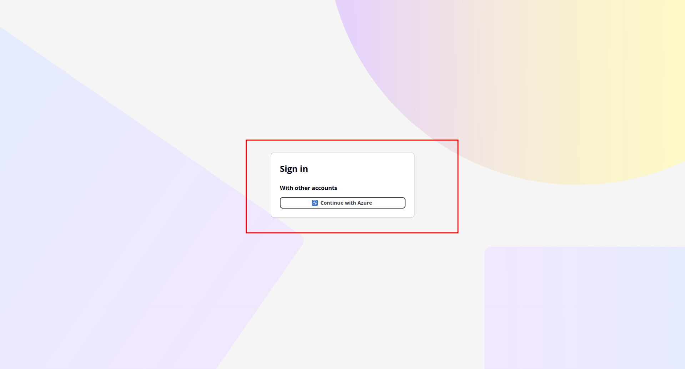
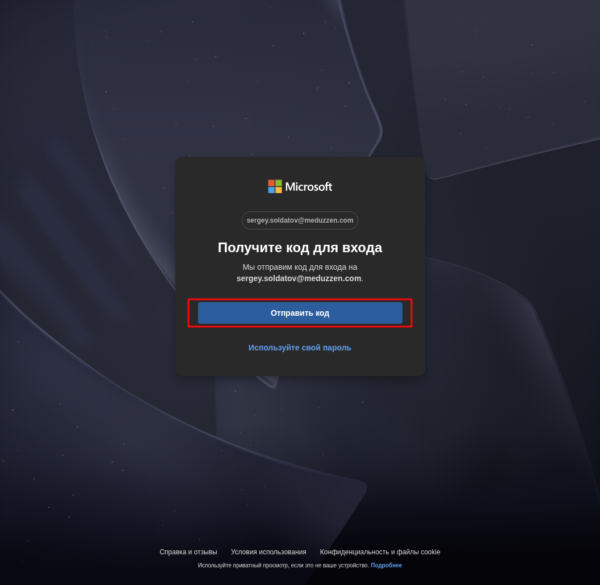
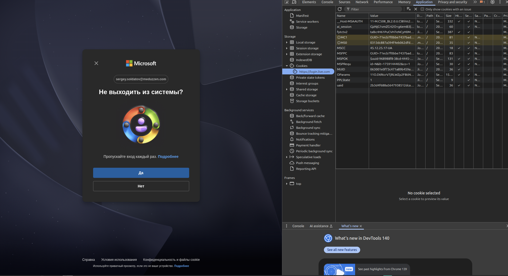
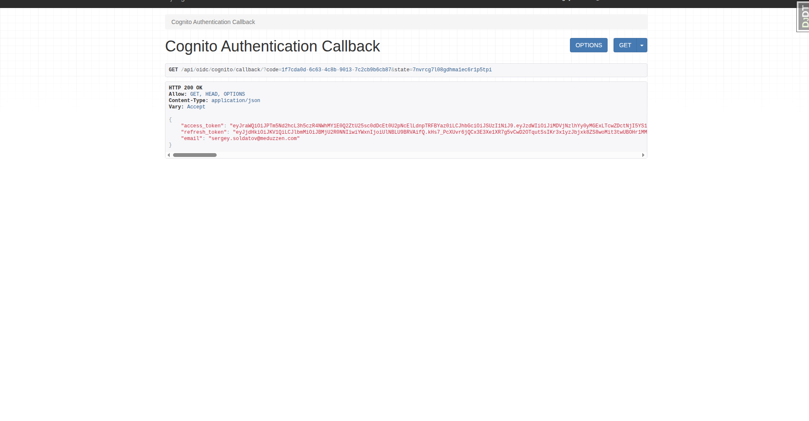
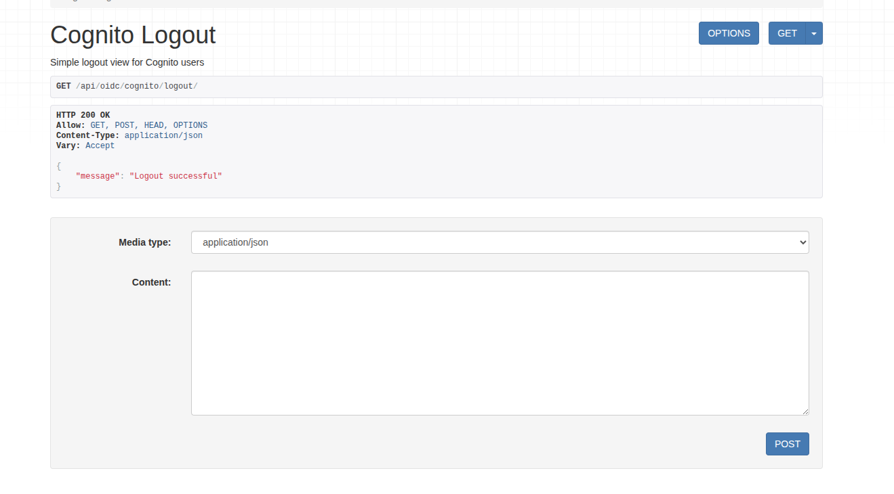
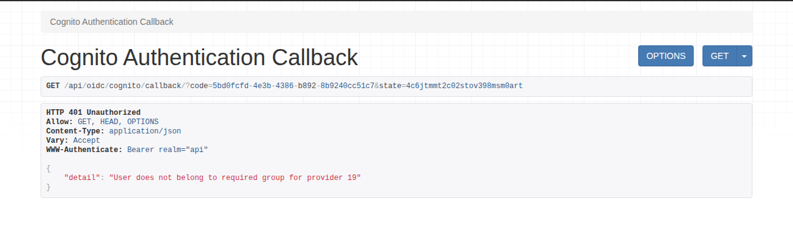

## Prerequisites for all OIDC providers

This guide covers the admin setup for SSO authentication built with Django and AWS Cognito. The full reference implementation is available on GitHub: [django-cognito-sso-demo](https://github.com/soldatov-ss/django-cognito-sso-demo).

To ensure SSO works correctly in your application, you must complete the following steps:

- Add OIDC Provider to the Cognito user pool to External Providers, for this you need **Client ID, Client Secret** and **Issuer ID** of OIDC Provider.
- Make sure that **SSO Provider** with this App Client credentials exists on your application.
- **Configure the “groups” claim** in the ID Token on your OIDC provider.

This is required for group validation to function properly in SSO.
- Add a custom **group** claim to Cognito by creating a custom attribute named **groups**.

The name must match the “groups” claim used in all OIDC providers that will be included in your application SSO.

After setting up the Admin Panel, we are ready to test SSO authentication.

---
 
## Provider setup guides
[Azure Single Sign-On (SSO) Setup: A Step-by-Step Guide](/blog/azure-sso-setup/)
 
[Okta Single Sign-On (SSO) Setup: A Step-by-Step Guide](/blog/okta-sso-setup/)

Other OIDC providers typically follow a similar setup process.

---

## Log in via Cognito

**Step 1:** To log in to your application via the Azure SSO Provider, send a GET request to:

`<cognito_domain>/login?client_id=<client_id>&redirect_uri=<redirect_uri>&response_type=code&scope=openid&state=<client_id>`

where:

1. **cognito_domain -** the AWS Cognito Domain
2. **region** - the AWS region where your Cognito User Pool is hosted (e.g., eu-central-1);
3. **client_id** - the Cognito App Client ID for the specific tenant (client);
4. **redirect_uri** - the callback URL configured in Cognito for your application (e.g., [https://yourapp.com/api/oidc/cognito/callback/](https://yourapp.com/api/oidc/cognito/callback/));
5. **state** - a parameter used to maintain state between the request and callback (here you must reuse the **client_id**).
6. Click on your Continue with your OIDC Provider name, that you enter in Cognito.

**Step 2** After sending the request, you will be redirected to the Your OIDC Provider login page, in my case it’s Microsoft login page. Click **Receive Code.**

**Step 3**:  Enter the code sent to **user_email**, then click **Yes**.

**Step 4:** After successful authentication, you will receive a response with your authentication tokens.

**Step 5:** To check if a user was actually created after SSO login, you can:

1. **Check via the Admin Panel:** Go to **Admin Panel → Users** and search for the user by email.
2. **Check via API:** Send a GET request to: `/api/users/me/`

## Testing log out

To log out, send a POST or GET request to:

`/api/oidc/cognito/logout/`

After successful logout you will receive a response with your message “Logout successful”.

## Group validation

If the user is **not a member** of the IAM group, the **group name** is incorrect in the Admin Panel for the SSO Provider, or the user’s **email domain** is not linked with a rights holder of the **app_id**, the login attempt will fail, showing an error, where **provider 19** is **SSO Client Provider ID**.

✅ **You have now successfully SSO authentication!**
